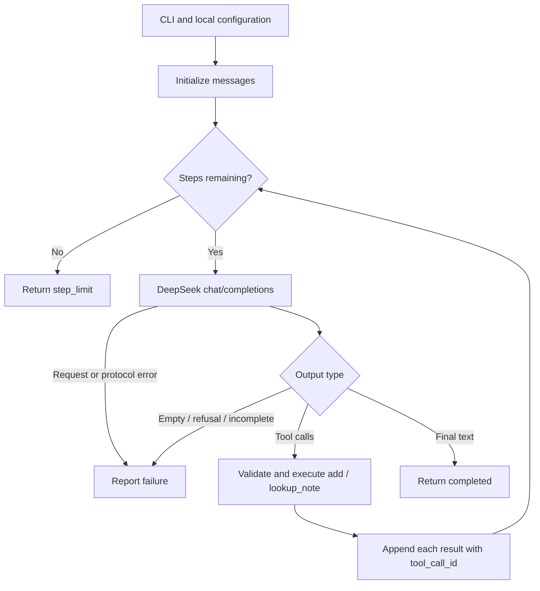
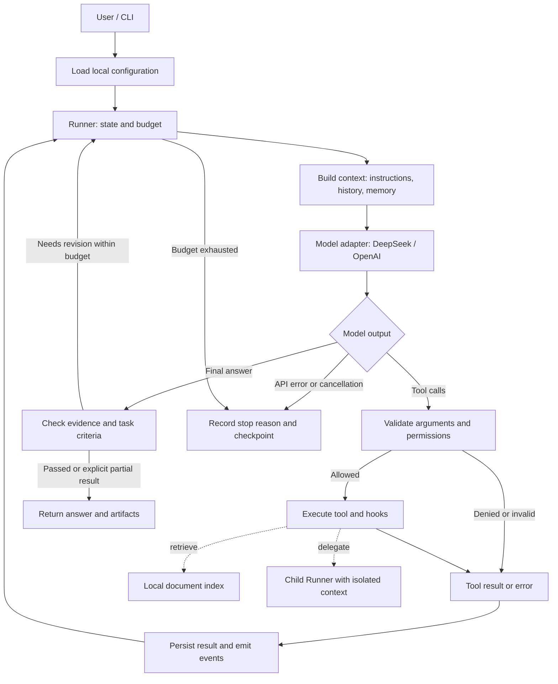

# ajAgent Architecture



> 当前已实现 Stage 0、Stage 1。上图对应 `examples/minimal_agent.py` 的实际流程；以下是后续逐步演进的目标架构。

## 目标流程



> 状态：**上述完整 harness 尚未实现**。Stage 1 只实现图中的模型 → 工具 → 回填 → 答案循环。其余模块按 [TODO](TODO.md) 逐步引入；本图不表示当前仓库已有这些功能。

## 1. 核心设计

模型提出下一步，Python 代码执行下一步。**Agent loop** 处理模型与工具之间的迭代；**harness** 组织上下文、执行权限、状态、预算、日志、恢复与验证。多 agent 复用同一个 Runner，通过任务输入和产物交换协作。

设计参考 Claude Code 的[官方工作原理](https://code.claude.com/docs/en/how-claude-code-works)，但采用独立、简化实现。公开插件代码的观察与固定版本链接在 [TODO 的参考依据](TODO.md#2-claude-code-参考依据与边界) 中，不把插件实现视作完整核心源码。

## 2. 模块职责与实现方式

| 模块 | 实现方式与职责 | 引入阶段 |
| --- | --- | --- |
| `examples/minimal_agent.py` | 单文件、自行维护消息、工具字典和有界循环；保留教学用途 | 1 |
| `config.py` | 加载 TOML/环境变量；把密钥留在模型客户端侧，不进入模型上下文 | 2；阶段 1 内联最小加载 |
| `cli.py` | 解析输入与配置选择，显示输出；不承载推理和工具逻辑 | 2 |
| `core/types.py` | 少量 dataclass 定义消息、调用、结果、状态；不建设复杂类层次 | 2 |
| `core/loop.py` | 请求模型、处理整批工具调用、回填结果、判断终止；唯一主循环 | 2 |
| `models/` | DeepSeek Chat Completions / OpenAI Responses 的字段、续接与 usage 映射 | 2 |
| `tools/` | ToolSpec 注册与执行；文件、数据库、检索、Web、浏览器、执行、委派逐步增加 | 2–6 |
| `rag/` | 文档解析、chunk、embedding、向量检索、证据映射和引用校验 | 3 |
| `context/` | 拼装本轮输入、预算估计、裁剪和摘要；不删除原始会话 | 4 |
| `memory/` | JSONL 会话历史、显式长期记忆的增删查和来源记录 | 4 |
| `harness/` | Runner 组合各组件，控制状态、策略、hooks、预算和事件；不复制 loop | 5 |
| `extensions/` | 按需 skill 加载与可选 MCP 工具适配 | 6 |
| `multi_agent/` | 角色配置、结构化 handoff、确定性路由、有界修订 | 7 |
| `tasks/` | 长任务进度、检查点、反馈候选；独立选修模块 | 8 |
| `evals/` | 固定用例与运行报告；评估成功率、证据、延迟和 token | 3 起持续完善 |

依赖方向：CLI → Runner → loop/context/model/tool 接口。工具通过显式参数获得 workspace 和运行上下文，不反向导入 CLI；RAG 由 retrieval 工具调用，不能另起隐藏的 agent loop。

## 3. 最小数据契约

这些字段是实现目标，可按实际需要简化；不是某家 API 的原样结构。

| 数据 | 关键字段 | 约束 |
| --- | --- | --- |
| `ModelTurn` | text、tool_calls、usage、stop_reason、continuation_items | 保留协议续接必需信息，不只抽取 text |
| `ToolCall` | call_id、name、arguments | ID 与结果一一关联；一轮可能有多个调用 |
| `ToolSpec` | name、description、input_schema、handler、effect | effect 区分 read/write/execute，供权限判断 |
| `ToolResult` | call_id、ok、data、error、sources、artifact_path | 错误是可反馈的结果；大输出引用 artifact |
| `Source` | source_id、uri、locator、excerpt、content_hash | locator 可以是行号、chunk、SQL 查询描述或网页位置 |
| `RunState` | run_id、session_id、status、step、budget、stop_reason | 完成、失败和上限停止不可混淆 |
| `Handoff` | task_id、goal、inputs、evidence_ids、artifact_paths、criteria、budget | 不默认共享父任务完整上下文 |

适配器分别负责 wire format：Chat Completions 的 assistant/tool 消息与 Responses 的 output items/function outputs 不强行压平成可互换消息。内部统一的是操作语义；原始协议续接状态由各适配器保存。跨厂商切换首版开启新 session。

## 4. 单次任务的执行顺序

1. CLI 读取用户任务；配置层构建厂商客户端，创建或恢复会话。
2. Runner 检查终止状态与预算，context builder 组装项目指令、必要记忆和本轮历史。
3. 模型适配器提交模型请求，解析成 ModelTurn，记录用量。
4. 若包含工具调用，先记录整批请求，逐个校验参数与权限；拒绝也生成对应结果。
5. 执行允许的工具，处理超时与错误，追加所有调用结果，再开始下一轮。
6. 若产生最终答案，按任务类型运行引用或产物检查；检查失败在修订上限内反馈，否则返回明确失败/部分结果。
7. 写入终态、停止原因、产物路径；用户能知道已完成什么和还缺什么。

首版全部串行。暂时的 API 错误可以重试请求，不能因此重新执行已完成工具。模型拒绝、空输出和格式错误必须有明确分支。

## 5. RAG 与记忆的数据流

**RAG：** 文档 → 带位置的 chunk → embedding → 本地索引；问题 → 同一 embedding 空间 → top-k → evidence map → 带 ID 的回答 → 引用校验。更新文档按 hash 失效旧 chunk，更换 embedding 模型重建索引。

**短期上下文：** 当前 API 请求的工作集，受 token 预算限制。

**会话历史：** 原始可恢复事件/消息；摘要不能覆盖它。

**长期记忆：** 用户明确保存的偏好、纠正或稳定事实；可删除、有来源，按需进入新会话。

**项目指令：** `AJAGENT.md`，由人维护的项目约定。它既不是检索知识库，也不是强制权限系统。工具权限由运行时代码执行。

引用校验能证明 ID 来自可用证据，但不能单独证明语义蕴含；评测必须检查事实与摘录是否一致。记忆同样不能作为未经核实的权威事实。

## 6. 配置与本地数据

已建立 `config.example.toml` 和被 `.gitignore` 排除的 `config.local.toml`，模板 key/model 为空，本地凭据由用户自行填写。Stage 1 已内联实现 DeepSeek 配置加载，其他厂商与 embedding 配置预留；模板结构为 `[deepseek]`、`[openai]`、`[embedding]`、`[runtime]`，各厂商分别持有 key、model、api_mode。

生成数据集中保存在忽略的 `.ajagent/` 下：

```text
.ajagent/
├── index/                    # Vectors, document hashes, embedding metadata.
├── sessions/                 # Original conversation history.
├── memory/                   # Explicit cross-session notes.
├── runs/<run_id>/             # Events, checkpoint, generated artifacts.
├── tasks/                    # Optional long-running progress.
└── eval-results/              # Local experiment outputs.
```

密钥不能出现在提示词、工具读取结果、日志或测试 fixture 中。文件工具不读取秘密配置；代码子进程只在学习工作目录中运行，并控制环境变量。它仍然是本机代码执行，不宣称提供完整沙箱隔离。

## 7. Hooks、恢复与协作边界

Hooks 首版是显式 Python 函数列表，只有 before_tool、after_tool、before_finish。策略在执行前决定是否允许；后置检查只提供结果反馈。检查失败最多触发有限次修订，避免永不结束。

Checkpoint 保存已完成结果和待处理状态。工具执行与文件写入无法天然组成原子事务：恢复时若一个有副作用的调用结果未知，先核对或请求用户处理；不自动重试。仅会话恢复不等于文件回滚。

Stage 7 coordinator 顺序调用独立上下文的 researcher/writer/reviewer/reviser。角色之间传递证据和产物，父级维护总预算和最终状态；多个角色使用同一模型也属于该实验。多 agent 是否更好由评测决定。

## 8. 当前范围与后续维护

Stage 0 已建立 uv 环境（Python 3.13）、pyproject.toml、uv.lock、配置模板、本地配置、忽略规则和学习日志。已安装 httpx 与 pytest。Stage 1 通过独立脚本实现配置加载、DeepSeek HTTP 请求、两个内存工具、消息回填和有界终止；配置优先级见 README。21 项离线测试与 deepseek-flash 的查笔记/加法真实演示通过。Stage 2 以后模块仍为计划。每阶段完成后同步更新本段、流程图和模块状态。

暂不做 Web UI、分布式执行、企业级权限、自动部署、复杂插件市场和多层 agent 递归。优先保持可读、可调试、可验证；新的模块应解决已遇到的问题。


## 9. Stage 1 实现映射

| 函数/数据 | 当前职责 |
| --- | --- |
| `TOOLS` / `NOTES` | 两个 JSON Schema 工具定义与固定学习笔记 |
| `add` / `lookup_note` | 纯本地执行，无文件或网络副作用 |
| `execute_tool` | JSON 解析、工具映射、参数错误转结果；不使用 eval |
| `load_config` | CLI/环境变量/本地 TOML 合并，校验必填配置与上限 |
| `run_agent` | messages → 请求 → 调用/答案分支 → 回填，最多 8 轮 |
| `main` | 命令解析、HTTP 客户端生命周期、错误摘要和退出码 |
| `tests/test_minimal_loop.py` | MockTransport 模拟模型响应，核对实际 HTTP 请求里的消息序列 |

当前不提供文件权限策略、日志持久化、会话恢复或自动重试。step_limit 表示未完成；工具错误可以进入下一轮，但网络/协议错误直接结束。本阶段不执行隐藏推理内容，只保留 API 续接所需消息。
