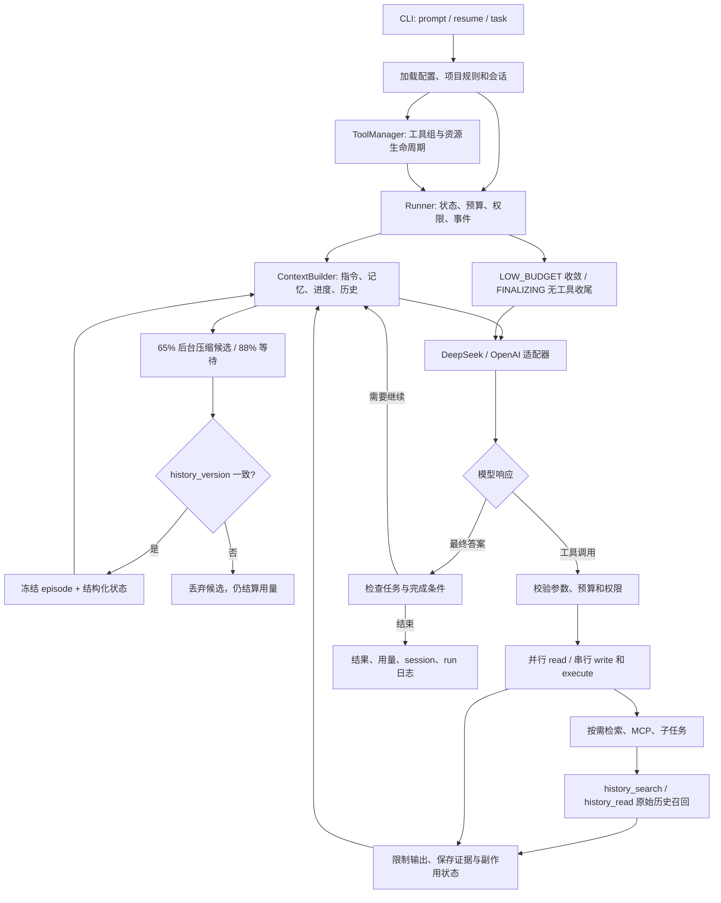

# Architecture



默认模式由主 agent 动态安排任务；Stage 7 的固定 research workflow 是单独的可选协调层。模型决定调用什么，Python 运行时决定是否允许执行、如何调度、是否达到完成条件。主流程不使用厂商 Agent SDK。

## 模块职责

| 模块 | 实现与职责 |
| --- | --- |
| `cli.py`、`config.py`、`options.py` | 解析命令与分片配置、校验参数、集中默认值，组装运行资源 |
| `core/loop.py`、`core/types.py` | 模型—工具—结果循环与统一响应类型，维护调用 ID 和续接消息 |
| `models/` | DeepSeek / OpenAI 协议适配、usage 和错误归一化；不执行工具 |
| `harness/` | Runner、Budget、权限、事件、状态、hooks、模型重试与 trace 回放 |
| `context/` | 输入预算估算、工具输出收缩、历史摘要与协议完整性 |
| `memory/` | JSONL 会话、恢复、累计用量、独立长期记忆 |
| `tools/common/`、`tools/runtime/` | ToolSpec、注册与调用校验、统一配置装配、资源关闭 |
| `tools/` 下各功能目录 | 文件、数据库、命令、网页、skills、MCP、委派、任务与检索的工具接口 |
| `rag/` | 本地、语义和联网检索，分块、索引、重排与统一来源信息 |
| `multi_agent/`、`agents/` | 可选的固定角色协调器、handoff 契约、角色提示词 |
| `tasks/` | 可恢复任务计划、实际验收、检查点与用户反馈 |
| `tests/` | 关键协议、权限、恢复、工具与预算行为的回归测试 |

入口命令与操作示例集中在 [README](../README.md)，阶段学习清单在 [TODO](TODO.md)。

## 配置与装配

`config/config.local.toml` 是默认入口，按 include 顺序递归合并配置，最后应用入口字段；表递归合并，数组整体替换。`Options` 负责默认值与类型校验，避免模块各自维护相同限额。

`runtime` 管运行与上下文，`models` 管厂商与密钥，`tools` 管工具组与能力限额，`rag` 管检索，`harness` 管执行预算与策略，`tasks` 管持久任务，`coordination` 管固定角色流程。MCP server 清单独立加载，不作为普通 include 分片。

include 路径相对声明文件；RAG、skills、mcp_config 等业务路径相对最外层配置入口；CLI 路径与 runtime.workspace 相对命令工作目录。MCP cwd 相对 MCP 配置文件。完整规则见 [配置目录](../config/README.md)。

`ToolManager` 按 `[tools].enabled` 装配所有工具组，统一处理 disabled 和依赖资源，不在 registry 中特殊硬编码 files/database。MCP、浏览器和子任务资源随运行关闭。模型只能看到实际注册的工具 schema。

## 工具调度与权限

工具包含名称、JSON Schema、处理函数和 read/write/execute 属性。通用层统一校验参数、序列化结果；Runner 再施加预算、审批、hooks 和事件记录。未知工具、非法参数和工具失败作为结构化观察返回，不能伪装成功。

同一模型响应中可并行的 read 调用按有限 worker 数执行，write/execute 顺序执行；完整工具结果按调用 ID 回填后再请求模型。该分类是调度约定，外部 MCP 的只读声明仍依赖配置与 server 的准确性。

权限为 allow/ask/deny。用户可批准 once、当前 scope 的 session 或会话 allow_all；deny 优先。权限状态随会话恢复。文件工具限制访问范围并排除秘密文件；检索可通过显式配置访问外部资料目录，不能因此获得任意外部写入权限。

命令使用 argv、可执行程序允许列表、超时和输出上限。较大观察写为 artifact，仅将受限摘录放入上下文。工具传输成功不代表命令 exit code 为 0，也不代表任务通过验收。

文件写入经 `FileHistory` 保存备份、diff 和前后哈希；恢复前核对当前内容，避免覆盖后来的修改。任意命令、数据库、网络等副作用不属于文件回滚范围。

## 上下文、会话和记忆

记忆分为三个生命周期：**原始 session 是可召回记录，context 是可替换的模型输入，长期 Memory 是经用户确认的跨会话偏好**。压缩不会删除或改写原始消息，也不会自动生成长期记忆。

### 三层工作上下文

| 层 | 保存什么 | 更新方式 |
| --- | --- | --- |
| FrozenEpisodeIndex | 原始 group 范围、SHA-256、结构化条目及其来源 ID | 只追加；已经冻结的 episode 永不再次交给摘要模型 |
| MutableStateCheckpoint | goals、constraints、decisions、progress、open_questions | 从冻结条目按时间确定性选择每类最近 N 条，不让模型反复改写摘要 |
| RecentRawTail | 最近完整协议组，以及当前请求 | 保留调用/结果对；较长工具输出可显示摘录，原始内容仍可 recall |

`context/compaction.py` 要求摘要返回严格 JSON。每条包含 `text` 和 `refs`；refs 只能指向本次输入中真实存在的 `g1`、`g2` 等 ID。Python 生成 episode 范围和哈希，模型不能自行指定已覆盖边界。假引用、超长条目、不完整输出都会拒绝提交，原始历史不变。来源身份校验不能证明摘要语义真实。

当前 checkpoint 有意采用容易理解的“选择”策略：保留最近条目，新的纠正优先；旧条目仍在冻结目录和原始 session 中，必要时主动召回。它不做语义冲突自动裁决，也不保证所有旧约束永远驻留 prompt。task 的持久进度交接可直接替换工作状态，同时为被隐藏的消息记录范围；当前用户请求另行保留，避免被合成的工具反馈提示挤掉。

模型只看到最近 `visible_episodes` 个目录项和有界状态；更早目录不再驻留输入，但所有原始 group 仍可按 ID 读取或搜索。这避免目录无限增长，不宣称完整前缀永远命中厂商缓存。

### Soft / hard 压缩与版本校验

比例针对 `context_tokens - output_tokens` 的可用输入预算，并包含工具定义；token 使用保守字节估算，而非厂商精确 tokenizer。

1. 低于 65%：正常使用原始上下文。
2. 65%–88%：单 worker 在不可变快照上生成候选，主请求可以继续；最多一个待提交候选。
3. 达到 88%：等待已有候选，然后同步压缩尚未覆盖的原始组，直到降压或仅剩保留尾部。大历史按能装入摘要请求的完整组分批处理。
4. 主线程提交前校验 `history_version`：它是完整历史与当前工作状态的内容指纹。追加消息、同长度改写、task handoff 都使旧候选失效；stale 就丢弃，绝不覆盖新状态。
5. 每次模型响应记录进历史前也检查已完成候选，让及时完成的后台结果有机会在版本变化前提交。

摘要请求本身也必须装入窗口，提交还需通过同口径的缩小检查。soft 失败保留原输入并记录诊断；hard 阶段无法压缩则明确返回 context_error。单个不可拆分的大 batch、过大的系统指令或近期用户消息仍可能无法容纳，不以破坏工具协议换取继续运行。

`ObservedModel.generate_summary` 使用独立 adapter 副本和同一 Budget 的线程安全预留/结算。后台摘要不会改变主模型的 last_usage；有效、无效以及 stale 候选的实际用量都计入 total usage。结束时先等待 worker 结算，再保存 session 结束记录并关闭 HTTP client；因此结束可能等待一次受模型超时/运行预算约束的请求。进程强制杀死时仍可能无法获取在途 API 的最终账单。

### 召回原始证据

`tools/history/recall.py` 提供统一工具组 `history`，通过 `[tools].enabled` 开关，默认启用：

- `history_search(query, cursor=0)`：当前 session 内不区分大小写的字面搜索，返回 group ID、命中摘录、扫描覆盖范围与下一页游标；不会访问其他 session。
- `history_read(group_id, offset=0)`：按字符分页读取完整原始协议组的 JSON 文本，返回 next_offset 和来源 URI。分页文本作为普通工具结果进入尾部，不重放其中的工具调用。

召回包含已压缩的内容、尚未压缩的尾部以及恢复前消息，经过 session 的脱敏函数。这里的原始内容指模型曾看见的协议消息；执行器另存的超长完整结果需使用 read_artifact，不会把日志中的额外内部事件直接注入模型。零结果仅说明没有字面匹配；可换关键词或按目录范围直接 read。原历史可能包含过时路径和错误结论，召回不能替代重新检查当前文件。

这里没有新增数据库或 embedding 依赖：直接在内存中的 session 消息上扫描，返回结果有界，扫描耗时与历史大小相关。它适合本地学习项目；超长历史的磁盘分页/FTS 可独立扩展。

### 持久化、恢复与配置

Session 为完整消息组写入稳定的 `group_id` 并复制输入，避免调用者事后修改已记录内容。JSONL 是原始记录；`context` 事件保存版本化 checkpoint、episode 目录与覆盖前缀哈希，`context_stats` 仅保存观察指标。候选未提交不影响恢复；checkpoint 在发布到工作上下文前落盘。恢复校验范围和哈希，错配则回到原始历史；旧版纯字符串摘要作为临时提示保留，但原始组重新进入可索引范围。

常规事件缓冲，完整协议组和关键 checkpoint 刷新；副作用 checkpoint 仍在执行前保存。`--resume` 要求原 workspace、provider、model。total usage 从上次 end 累计，last_usage 仅为主模型最后请求；原有 Memory 的 remember/list/forget 和反馈审核机制保持独立。

所有参数位于 `config/runtime.local.toml` 的 `[limits.context]`：

```toml
summarization_enabled = true
speculative = true
soft_ratio = 0.65
hard_ratio = 0.88
recent_groups = 2
state_entries = 3
entry_chars = 300
visible_episodes = 3
summary_output_tokens = 2048
history_page_chars = 3000
history_search_results = 8
history_snippet_chars = 240
```

`speculative=false` 只关闭后台生成，hard 压缩仍保留；`summarization_enabled=false` 关闭模型压缩，超窗时仍保留原始历史。history 工具是独立开关，即使不压缩也能使用。example 与 local 配置均已更新。

### 参考与验证

参考 [OpenAI Compaction 文档](https://developers.openai.com/api/docs/guides/compaction) 的窗口管理和 [Codex compact.rs](https://github.com/openai/codex/blob/main/codex-rs/core/src/compact.rs) 的压缩/历史替换边界。OpenAI 的原生 compact 返回 opaque 状态；本项目为兼容双厂商采用可读 JSON，不实现同等模型内部记忆，也不声称 65%/88% 是 Codex 的固定策略。

三层思路参考 [DSH recallable compaction 提案镜像](https://huggingface.co/SaylorTwift/deepseek-harness/blob/main/.agents/notes/proposed/feature/2026-07-06-recallable-compaction.md)，该文档标为 proposed。本项目简化为单后台 worker、原始 group 地址和确定性状态选择，没有复制其插件系统、并行多 region 提交或可变状态重写机制。

`tests/test_recallable_context.py` 覆盖 soft 不阻塞、hard 等待、同长度历史变更导致 stale、重复压缩不重写旧 episode、DeepSeek/Responses 工具配对、伪造引用拒绝、分页召回、恢复一致性、任务交接冲突和后台用量结算，并让脚本模型通过真实 loop 调用 recall 工具找回被省略的细节。

2026-10-25 的一次真实 DeepSeek 小样本保留了“17 天改为 23 天”的纠正并通过召回/恢复检查，估算输入从 2386 降至 560 token；实际摘要请求为 1371 input / 170 output tokens。这是接口烟雾测试，不是长期记忆准确率结论。

## Budget 与结束协议

`harness/budget.py` 的 `Budget` 统一统计 steps、工具调用、token 和时间；子任务与摘要不能绕过父预算。配置与 CLI 决定上限，启动输出实际值。一次恢复建立新运行预算，但 session 费用累计继续保留。

- **HIGH_BUDGET**：允许探索、调查与实现。
- **LOW_BUDGET**：系统提示要求聚焦未完成交付物、减少重复观察，优先验收。
- **FINALIZING**：不再提供工具，使用有界上下文与输出额度尝试最终总结。

阶段按剩余资源计算；steps 单独预留最后一步，避免长任务过早按比例失去工具能力。重复调用和任务长时间无进展会触发收敛提示，不自动提高额度。硬时间或 token 已不足时，不能保证还能发出最后一次请求。

API 错误与预算结束分别记录。模型请求对可恢复的网络、限流和服务端错误作有界重试，不因此重放工具副作用；账单或参数错误不应当靠提高 steps 解决。错误日志保留类别、状态与请求诊断，避免输出密钥。

## RAG 与读取缓存

RAG 通过可选 `retrieve` 工具接入；启用后也不要求每个问题检索。Local Search 使用 rg / Tree-sitter；Semantic Search 按文档结构或代码符号分块，以 NumPy、SQLite、HNSW 保存向量和来源；Web Search 使用 Tavily 官方客户端。统一层合并、去重、排序并可使用 Qwen 重排，返回来源与诊断。

知识库原文和索引位置可独立指定。索引按 generation 构建并发布 CURRENT，增量更新复用未变化内容；旧 generation 不自动回收。原文提取与索引数据布局见 [RAG README](../src/ajagent/rag/README.md)。

`tools/files/cache.py` 为 read_file 提供有界内存 LRU。每次访问仍检查路径权限与文件元数据，修改、替换或元数据变化使缓存失效；不缓存审批或副作用。`limits.tools.read_cache_bytes` 控制缓存数据容量，0 关闭；该数值不是进程总内存上限。

来源可追溯仅证明来源身份，不证明回答语义一定得到支持。抓取与搜索内容按不可信资料处理。

## 子任务与固定 workflow

动态 `delegate` 使用独立上下文和 task contract，约束目标、输入、验收与返回内容。同一步可并行多个子任务；worker 不递归委派，不直接修改共享文件。子任务返回分析或 proposal，主 agent 检查并顺序 apply，避免多个写入者互相覆盖；仍需实际测试验证语义一致性。

固定 research workflow 复用 Runner，按 research → write → review → revise 路由。角色输出遵循 JSON handoff；证据 ID 必须来自实际观察，coordinator 统一保存版本与发布。修订和失败重试均有上限，审阅不通过则保留草稿并返回 partial，不能创建成功的 final.md。

默认不开启固定 workflow，也不支持固定 workflow 的 `--resume` / `--task`。角色与产物细节见 [协作说明](../src/ajagent/multi_agent/README.md)。

## 持久任务、恢复与反馈

复杂任务由 plan_tasks 建立小目标、required paths 和验收命令，状态为 pending/running/passed/failed。一个主 agent 持有任务锁，逐项目实现；verify_task 真正执行检查，要求 exit code、产物与文件哈希满足条件后才能标 passed。后续修改使旧验收失效。

checkpoint_task 保存进度；默认在完整协议批次边界刷新工作上下文，留下用户目标、规则与事实进度，避免不断重发旧观察。原 session 与累计用量保留。`--task` 开新会话读取计划；`--resume` 则恢复会话及绑定任务。

```text
.ajagent/
├── sessions/              # 会话消息、审批和累计用量
├── runs/                 # 事件、运行状态、检查点与 artifacts
├── tasks/<task_id>/
│   ├── tasks.json        # 权威任务状态与验收证据
│   ├── progress.md       # 面向人和模型的进度投影
│   ├── checkpoints/
│   └── feedback/
└── changes/              # 文件工具的备份与 diff
```

副作用可能已执行但结果未知时，恢复不会自动重放；需核对真实状态后再使用 `--acknowledge-unknown`。任务锁使用 POSIX flock，当前面向 Linux/macOS。没有后台无限重启、跨机器调度或环境整体回滚。详细状态规则见 [任务说明](../src/ajagent/tasks/README.md)。

## 可观测性与验证

Runner 记录模型调用、工具开始/结束、预算阶段、失败和最终状态。`ajagent-trace --replay` 只读取已有事件，不访问模型或重做操作；中断和失败保留已有产物及诊断。

使用 `uv run pytest -q tests` 检查运行协议、权限拒绝、共享预算、缓存失效、索引更新和中断恢复等行为。回归测试属于实现维护；运行日志留在工作目录，不将生成项目或历史试验报告作为主文档的一部分。
