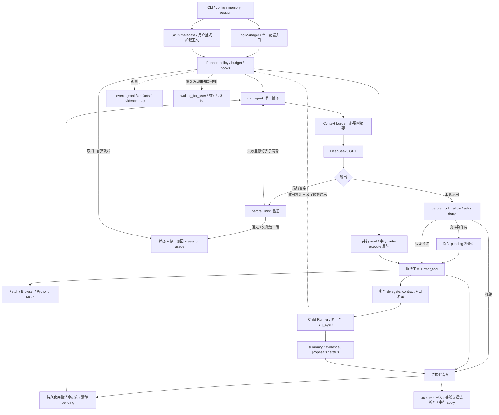
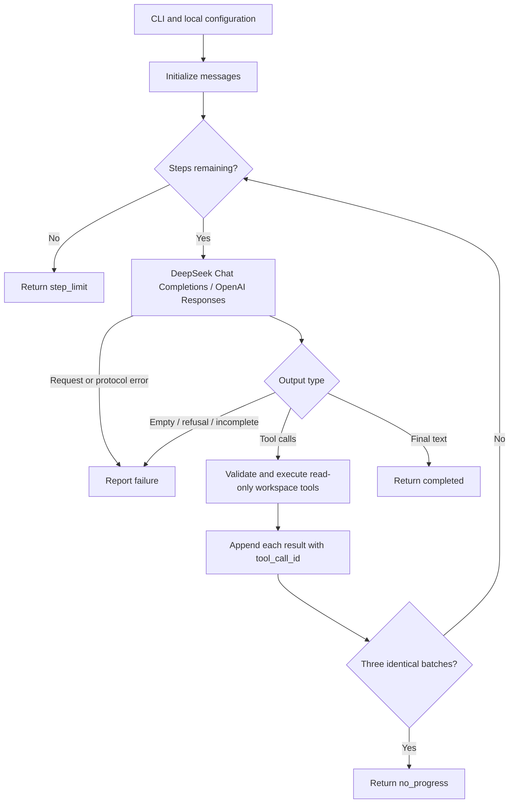
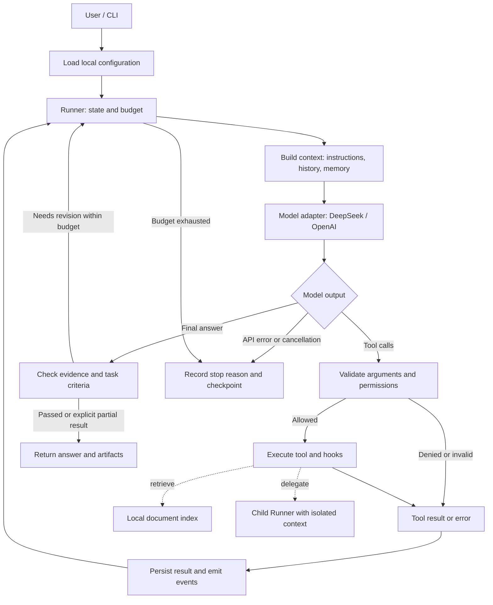

# ajAgent Architecture




> 当前 RAG 是可选工具；详细数据流与限制见 [RAG README](../src/ajagent/rag/README.md)。

## 基础工具 CLI 流程



> 当前已实现 Stage 0–5。上图对应 `src/ajagent/core/loop.py` 的实际流程；以下是后续逐步演进的目标架构。

## 目标流程



> 状态：Stage 5 已实现 Runner、状态、预算、权限、hooks、日志与恢复。图中 delegate/Child Runner 属于后续阶段，尚未实现。

## 1. 核心设计

模型提出下一步，Python 代码执行下一步。**Agent loop** 处理模型与工具之间的迭代；**harness** 组织上下文、执行权限、状态、预算、日志、恢复与验证。多 agent 复用同一个 Runner，通过任务输入和产物交换协作。

设计参考 Claude Code 的[官方工作原理](https://code.claude.com/docs/en/how-claude-code-works)，但采用独立、简化实现。公开插件代码的观察与固定版本链接在 [TODO 的参考依据](TODO.md#2-claude-code-参考依据与边界) 中，不把插件实现视作完整核心源码。

## 2. 模块职责与实现方式

| 模块 | 实现方式与职责 | 引入阶段 |
| --- | --- | --- |
| `examples/minimal_agent.py` | 单文件、自行维护消息、工具字典和有界循环；保留教学用途 | 1 |
| `options.py` | 不可变配置分组、统一默认值与校验，向各模块显式传递 | 5 后整理 |
| `config.py` | 加载 TOML/环境变量；把密钥留在模型客户端侧，不进入模型上下文 | 2；阶段 1 内联最小加载 |
| `cli.py` | 解析输入与配置选择，显示输出；不承载推理和工具逻辑 | 2 |
| `core/types.py` | 少量 dataclass 定义消息、调用、结果、状态；不建设复杂类层次 | 2 |
| `core/loop.py` | 请求模型、处理整批工具调用、回填结果、判断终止；唯一主循环 | 2 |
| `models/` | DeepSeek Chat Completions / OpenAI Responses 的字段、续接与 usage 映射 | 2 |
| `tools/` | ToolSpec 注册与执行；文件、数据库、检索、Web、浏览器、执行、委派逐步增加 | 2–6 |
| `rag/` | 分层检索、chunk、Qwen embedding/rerank、HNSW 与增量索引 | 3 |
| `context/` | 拼装本轮输入、预算估计、裁剪和摘要；不删除原始会话 | 4 |
| `memory/` | JSONL 会话历史、显式长期记忆的增删查和来源记录 | 4 |
| `harness/` | Runner 组合各组件，控制状态、策略、hooks、预算和事件；不复制 loop | 5 |
| `tools/skills/`、`tools/mcp/` | 按需 skill 与持久 MCP 子系统 | 6 |
| `multi_agent/` | 角色配置、结构化 handoff、确定性路由、有界修订 | 7 |
| `tasks/` | 长任务进度、检查点、反馈候选；独立选修模块 | 8 |
| `evals/` | 后续固定用例与运行报告；评估成功率、证据、延迟和 token | 5 起 |

依赖方向：CLI → Runner → loop/context/model/tool 接口。工具通过显式参数获得 workspace 和运行上下文，不反向导入 CLI；RAG 由 retrieval 工具调用，不能另起隐藏的 agent loop。

## 3. 最小数据契约

这些字段是实现目标，可按实际需要简化；不是某家 API 的原样结构。

| 数据 | 关键字段 | 约束 |
| --- | --- | --- |
| `ModelTurn` | text、tool_calls、usage、stop_reason、continuation_items | 保留协议续接必需信息，不只抽取 text |
| `ToolCall` | call_id、name、arguments | ID 与结果一一关联；一轮可能有多个调用 |
| `ToolSpec` | name、description、input_schema、handler、effect | effect 区分 read/write/execute，供权限判断 |
| `ToolResult` | call_id、ok、data、error、sources、artifact_path | 错误是可反馈的结果；大输出引用 artifact |
| `Source` | source_id、uri、locator、excerpt、content_hash | locator 可以是行号、chunk、SQL 查询描述或网页位置 |
| `RunState` | run_id、session_id、status、step、budget、stop_reason | 完成、失败和上限停止不可混淆 |
| `Handoff` | task_id、goal、inputs、evidence_ids、artifact_paths、criteria、budget | 不默认共享父任务完整上下文 |

适配器分别负责 wire format：Chat Completions 的 assistant/tool 消息与 Responses 的 output items/function outputs 不强行压平成可互换消息。内部统一的是操作语义；原始协议续接状态由各适配器保存。跨厂商切换首版开启新 session。

## 4. 单次任务的执行顺序

1. CLI 读取用户任务；配置层构建厂商客户端，创建或恢复会话。
2. Runner 检查终止状态与预算，context builder 组装项目指令、必要记忆和本轮历史。
3. 模型适配器提交模型请求，解析成 ModelTurn，记录用量。
4. 若包含工具调用，先记录整批请求，逐个校验参数与权限；拒绝也生成对应结果。
5. 执行允许的工具，处理超时与错误，追加所有调用结果，再开始下一轮。
6. 若产生最终答案，按任务类型运行引用或产物检查；检查失败在修订上限内反馈，否则返回明确失败/部分结果。
7. 写入终态、停止原因、产物路径；用户能知道已完成什么和还缺什么。

同一步中的独立 read 工具可并行，write/execute 按原顺序串行。暂时的 API 错误可以重试请求，不能因此重新执行已完成工具。模型拒绝、空输出和格式错误必须有明确分支。

## 5. RAG 与记忆的数据流

**RAG：** Agent 按需调用 retrieve → Local/Semantic/Web 召回 → 去重/RRF → 可选 Qwen rerank → 有界证据。Semantic 使用 Qwen query embedding 和 HNSW，索引增量更新并原子发布；正文缓存独立保存。当前最终回答引用路径/行号或 URL，不运行强制引用 guard。

**短期上下文：** 当前 API 请求的工作集，受 token 预算限制。

**会话历史：** 原始可恢复事件/消息；摘要不能覆盖它。

**长期记忆：** 用户明确保存的偏好、纠正或稳定事实；可删除、有来源，按需进入新会话。

**项目指令：** `AJAGENT.md`，由人维护的项目约定。它既不是检索知识库，也不是强制权限系统。工具权限由运行时代码执行。

引用校验能证明 ID 来自可用证据，但不能单独证明语义蕴含；评测必须检查事实与摘录是否一致。记忆同样不能作为未经核实的权威事实。

## 6. 配置与本地数据

配置集中在 `config/`：入口 `config.local.toml` 通过 include 加载 runtime、models、tools、rag、harness 分片。模型凭据位于 `models.local.toml`，Tavily 与检索参数位于 `rag.local.toml`；所有 local 文件均被 Git 忽略。路径相对入口目录（workspace 相对工作目录），示例使用 `../knowledge` 指向根目录知识库。

生成数据集中保存在忽略的 `.ajagent/` 下：

```text
.ajagent/
├── models/                   # Local Qwen weights.
├── sessions/                 # Original conversation history.
├── memory/                   # Explicit cross-session notes.
├── runs/<run_id>/             # Events, checkpoint, generated artifacts.
├── tasks/                    # Optional long-running progress.
└── eval-results/              # Local experiment outputs.
```

密钥不能出现在提示词、工具读取结果、日志或测试 fixture 中。文件工具不读取秘密配置；代码子进程只在学习工作目录中运行，并控制环境变量。它仍然是本机代码执行，不宣称提供完整沙箱隔离。

## 7. Hooks、恢复与协作边界

Hooks 首版是显式 Python 函数列表，只有 before_tool、after_tool、before_finish。策略在执行前决定是否允许；后置检查只提供结果反馈。检查失败最多触发有限次修订，避免永不结束。

Checkpoint 保存已完成结果和待处理状态。工具执行与文件写入无法天然组成原子事务：恢复时若一个有副作用的调用结果未知，先核对或请求用户处理；不自动重试。仅会话恢复不等于文件回滚。

Stage 7 coordinator 顺序调用独立上下文的 researcher/writer/reviewer/reviser。角色之间传递证据和产物，父级维护总预算和最终状态；多个角色使用同一模型也属于该实验。多 agent 是否更好由评测决定。

## 8. 当前范围与后续维护

Stage 0 已建立 uv 环境（Python 3.13）、pyproject.toml、uv.lock、配置模板、本地配置、忽略规则和学习日志。已安装 httpx 与 pytest。Stage 1 通过独立脚本实现配置加载、DeepSeek HTTP 请求、两个内存工具、消息回填和有界终止；配置优先级见 README。21 项离线测试与 deepseek-flash 的查笔记/加法真实演示通过。Stage 2 已实现 config、cli、core、models、tools；Stage 3 已实现分层 rag、可选 retrieve 和 Qwen rerank；Stage 4 已实现 context/memory 和会话恢复；Stage 5 已实现 harness；Stage 6 起的外部工具与委派仍为计划。每阶段完成后同步更新本段、流程图和模块状态。

暂不做 Web UI、分布式执行、企业级权限、自动部署、复杂插件市场和多层 agent 递归。优先保持可读、可调试、可验证；新的模块应解决已遇到的问题。


## 9. Stage 1 实现映射

| 函数/数据 | 当前职责 |
| --- | --- |
| `TOOLS` / `NOTES` | 两个 JSON Schema 工具定义与固定学习笔记 |
| `add` / `lookup_note` | 纯本地执行，无文件或网络副作用 |
| `execute_tool` | JSON 解析、工具映射、参数错误转结果；不使用 eval |
| `load_config` | CLI/环境变量/本地 TOML 合并，校验必填配置与上限 |
| `run_agent` | messages → 请求 → 调用/答案分支 → 回填，最多 8 轮 |
| `main` | 命令解析、HTTP 客户端生命周期、错误摘要和退出码 |
| `tests/test_minimal_loop.py` | MockTransport 模拟模型响应，核对实际 HTTP 请求里的消息序列 |

Stage 1 示例不提供文件权限策略、日志持久化、会话恢复或自动重试。step_limit 表示未完成；工具错误可以进入下一轮，但网络/协议错误直接结束。本阶段不执行隐藏推理内容，只保留 API 续接所需消息。


## 10. Stage 2 实现映射

- `config.py`：dataclass 保存一次运行配置，key 不参与 repr；选择厂商后只读取其密钥，CLI > 环境变量 > 文件 > 默认值。
- `models/base.py`：ModelClient 协议和 HTTP 重试；HTTPModel 只复用传输机制，不统一 wire format。失败摘要不包含原始 API 响应体。
- `models/deepseek.py`：Chat Completions schema、消息、reasoning_content 与 tool_call_id 映射。
- `models/openai.py`：Responses schema、output items、call_id 与 function_call_output；store=false，完整回传 opaque reasoning。
- `core/types.py`：ToolCall、ModelTurn、ToolResult、RunResult；usage 统一为 input_tokens/output_tokens。
- `core/loop.py`：唯一包内循环，批次顺序执行、错误回填、用量累计、步数和重复批次终止。独立 Stage 1 示例仅作教学保留。
- `tools/common/base.py`、`tools/common/registry.py`：普通字典注册、JSON Schema 校验、结构化结果和字符上限；意外工具异常隔离为 tool_error。
- `tools/files/workspace.py`：workspace 路径边界、配置/隐藏路径与链接排除、UTF-8 行读取、字面量扫描；来源是文件路径和行号。
- `tools/database/sqlite.py`：只读 URI + authorizer，禁止写入/ATTACH/PRAGMA；progress handler 控制查询时间，fetchmany 控制结果行数。
- `cli.py`：组合配置、模型与 registry，输出简短工具状态、最终答案与 token 数；不持久保存历史。

单次结果默认限制 6000 字符；截断会提供重新缩小查询的提示，丢弃不完整的 sources。连续三轮相同批次/相同结果判为无进展，不等价于通用语义进度检测。文件/SQL 超时是合作式机制，本阶段没有任意工具强制中断或安全沙箱。

验证：`tests/test_stage2.py` 与 Stage 1 测试合计 54 项通过。两家真实模型均完成 fixture 文件搜索和读取，证明适配器实际闭环；这不代表所有模型/参数都支持相同协议。参考 [OpenAI Function calling](https://developers.openai.com/api/docs/guides/function-calling) 和 [Responses migration](https://developers.openai.com/api/docs/guides/migrate-to-responses)。


## 11. Stage 3 分层实现

| 模块 | 职责 |
| --- | --- |
| `rag/local/` | rg 精确搜索；Tree-sitter 符号与位置 |
| `rag/semantic/chunks.py` | 文档章节、代码定义边界；PDF 文本提取 |
| `rag/semantic/encoder.py` | 懒加载 Qwen；query instruction、last-token pooling |
| `rag/semantic/store.py` | SQLite 元数据、独立 txt、NumPy 向量、增量 HNSW、generation 发布 |
| `rag/web/` | Tavily SDK、摘录证据、URL 去重与单次请求错误返回 |
| `rag/ranking/` | Qwen yes/no cross-encoder，最后 token logits |
| `rag/service.py` | 配置、统一检索、多源去重/RRF、部分错误和精排 |
| `tools/retrieval/search.py` | 可选 ToolSpec 与输出预算 |
| `rag/cli.py` | 无聊天 key 的 index/update/search 命令 |
| `rag/knowledge.py` | 独立源目录与输出目录的构建/更新接口；仅凭索引位置打开 |

`[tools].enabled` 中的 `retrieval` 控制是否注册检索工具，开启不意味着必须调用。模型权重只在实际检索/精排时加载。Web 默认不启用。backend 失败转 warnings，模型需区分“检索失败”和“确实没有证据”。

详细实现、数据格式、性能边界和验证见 [RAG README](../src/ajagent/rag/README.md) 与 [新版报告](experiments/rag-validation.md)。没有全自动事实核验、索引 GC 或持久会话；后续 harness 能在现有工具接口上加入这些能力。

## 文件范围与知识库位置

`tools/` 下按 common/runtime/files/database/retrieval/execution/web/delegation/skills/mcp 分组；共享协议、registry 和 evidence 放在 common，根目录仅保留包标记。文件与数据库工具仍以 agent workspace 为边界；RAG Local Search 可以通过 `[rag].local_path` 独立选择项目外目录或单个文件。

SemanticIndex 的 root 是知识库源目录，不再绑定 agent workspace。index/update 将来源绝对路径与 embedding/chunk 配置保存在 SQLite settings 中；open_knowledge 读取这些 metadata，因此 agent 只需 `[rag].index` 即可使用外部索引。源文件仍需可访问用于 hash 新鲜度检查。service 在跨来源融合前把本地 URI 转为绝对路径，避免同名文件冲突。

默认布局为 `knowledge/*` 原文与 `knowledge/.index/{CURRENT,texts,gen-*}` 生成文件；生成目录从扫描中排除。模型缓存继续放在 `.ajagent/models`。TOML 路径相对配置文件目录，CLI 路径相对当前目录，二者均可使用绝对路径。


## Stage 4 当前实现

| 模块 | 实现与职责 |
| --- | --- |
| `context/builder.py` | 构建输入副本、估算 token、扣除输出预算；超限先裁剪工具输出，再摘要较旧批次；保留最新用户消息与最近两个完整批次 |
| `context/compaction.py` | 调用当前模型生成带目标、约束、完成项、未解问题、证据位置的摘要；一次失败即结束 |
| `memory/session.py` | JSONL 追加事件；以完整模型输出及其全部工具结果为 replay 单位；恢复检查 provider/model，并读取摘要检查点 |
| `memory/long_term.py` | workspace scope 显式记忆的增改查删，JSON 权威记录和 Markdown 可读投影；20 条、每条 1000 字符 |
| `memory/cli.py` | `ajagent-memory remember/list/forget`，`remember --id` 更新，无需模型凭据 |
| `cli.py` | 加载根目录 AJAGENT.md、可选记忆、会话和 builder；输出 Session ID、estimated 预算与结束状态 |

原始历史、输入副本、长期偏好各自独立。系统指令与记忆在每次启动时重建，恢复时不会回放旧 system 事件。原始工具结果在输出裁剪前记录；OpenAI reasoning 等协议项目随完整批次保留，压缩不能拆开 call/output。摘要作为历史数据消息注入，不成为新的项目指令。原始历史保留，不会因为摘要而删除；摘要内容由模型生成，并非可证明无损。

当前实现是单进程、单会话写入，摘要遇到超大历史时明确停止而不递归摘要。forget 删除显式记忆，不会清除旧对话文本。配置和操作示例见 README，测试见 `tests/test_context.py`、`tests/test_memory.py`。


会话写入采用内存 JSONL 缓冲：完整 replay 批次、约 64 KiB 阈值、运行退出时刷新。`append` 不再每次打开文件；`record` 是批次检查点。`run_agent` 统一在 finally 刷新，即使模型失败或用户取消也执行。Session 从最近 end 恢复 usage 累计快照，run_agent 将本次主模型与摘要增量加到该基线上，更新内存 usage 并统一写入一个 end。CLI 只显示结果，不重复累计或写 end。last_usage 单独保留本次运行最后主模型响应的报告值。


## Stage 5 当前实现

| 文件 | 职责 |
| --- | --- |
| `harness/runner.py` | 组合现有循环，执行权限和 hooks；保存 pending 检查点；将中断映射为状态 |
| `harness/model.py` | 观测模型调用、统计 usage/耗时；将预算传给 HTTP 层 |
| `harness/state.py` | running/waiting_for_user/completed/failed/cancelled 与 reason 分离 |
| `harness/budget.py` | 当前 run 的工具数、token、墙钟预算；步数沿用 loop |
| `harness/policy.py` | allow/ask/deny，session 内目标路径或完整命令授权，deny 优先 |
| `harness/events.py` | run_id/step/call_id 事件、已知密钥脱敏、artifact、临时文件替换 checkpoint |
| `harness/hooks.py` | 三个 hook 点、修改文件跟踪、Markdown 本地目标检查和可选检查命令 |
| `harness/trace.py` | 无执行行为的离线 trace 查看/回放，以及测试用 FakeModel |
| `tools/execution/runtime.py` | 写入 diff 预览和工作区路径检查；argv 子进程、输出/超时限额、取消时清理进程组 |

Runner 没有第二个推理循环；loop 只在步骤开始、上下文完成、工具执行、批次完成和最终候选答案处通知 harness。不传 harness 时仍可直接使用基础循环。已完成批次先写 session，再清除 pending；执行后尚未完成这一顺序时保持 unknown。未知副作用阻止新运行，要求显式核对。after_tool 无法撤销已经完成的写入。

Session total usage 仍从上一次 end 快照累计。Runner 观测全部主模型与摘要请求，取消/预算结束也记录已报告用量；last_usage 保留主模型的最后一次响应，摘要不覆盖它。恢复的历史 usage 不计入新 run 的预算。价格不在当前实现范围内。

日志不复制无限工具输出；较大结果写到脱敏 artifact，协议结果只传预览和读取位置。Markdown 引用检查是局部语法/文件存在性检查，不能证明语义支持。进程内工作在边界检查预算；命令不是沙箱。完整限制和 CLI 参数见 README。

配置与职责整理见 [configuration](configuration.md)：工具 prepare/invoke 统一、HTTP 超时单一归属、Session.finish 统一记录结束状态。

## 统一工具入口与并行任务

`tools/runtime/loader.py::ToolManager` 是唯一装配入口，读取 `[tools]`，创建所需工具并统一管理资源清理。`common/registry.py` 只包含通用解析、校验、分发和序列化。CLI 与 Runner 不再分别增加工具；扩展分类目录已移除。

- Skills：启动只注入 metadata，`load_skill` 与用户 `/skill` 共用正文加载器。
- MCP：`MCPManager` 管理多个持久 client；每个 server 的线程内维持同一 SDK session，支持 stdio 与 Streamable HTTP。根据本地配置赋予 read/execute 状态，工具名包含 server 名。
- 调度：Runner 将连续且可并行的只读调用提交线程池，写/执行操作形成串行屏障，结果按原 call 顺序回填。页面状态、模型缓存等需要额外串行约束。
- 子任务：主 agent 可在同一步提出多个带 contract 的 delegate 调用；child 只读与输出内部提案，隔离消息、模型适配器与状态；共享父级预算锁、在途 token 预留和全局取消信号。
- Single writer：child 生成候选内容和 diff artifact。主 agent 审阅后串行 apply，执行基线 hash、路径和语法检查，再进入既有验证反馈；逻辑冲突仍由主 agent 和测试判断。

详细字段、目录职责与数据流见 [Tools README](../src/ajagent/tools/README.md)、[MCP README](../src/ajagent/tools/mcp/README.md) 和 [配置说明](configuration.md)。

参考 [Claude Code 子代理](https://code.claude.com/docs/en/sub-agents) 的独立上下文/工具访问、[Skills](https://code.claude.com/docs/en/skills) 的按需指导，以及 [MCP 传输规范](https://modelcontextprotocol.io/specification/2025-06-18/basic/transports)。这是本项目的简化实现，不宣称复刻闭源内部代码。
