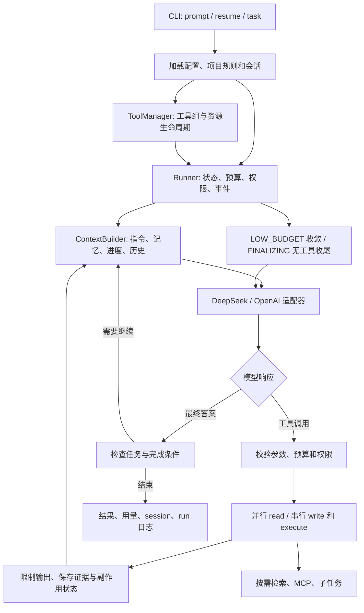

# Architecture



默认模式由主 agent 动态安排任务；Stage 7 的固定 research workflow 是单独的可选协调层。模型决定调用什么，Python 运行时决定是否允许执行、如何调度、是否达到完成条件。主流程不使用厂商 Agent SDK。

## 模块职责

| 模块 | 实现与职责 |
| --- | --- |
| `cli.py`、`config.py`、`options.py` | 解析命令与分片配置、校验参数、集中默认值，组装运行资源 |
| `core/loop.py`、`core/types.py` | 模型—工具—结果循环与统一响应类型，维护调用 ID 和续接消息 |
| `models/` | DeepSeek / OpenAI 协议适配、usage 和错误归一化；不执行工具 |
| `harness/` | Runner、Budget、权限、事件、状态、hooks、模型重试与 trace 回放 |
| `context/` | 输入预算估算、工具输出收缩、历史摘要与协议完整性 |
| `memory/` | JSONL 会话、恢复、累计用量、独立长期记忆 |
| `tools/common/`、`tools/runtime/` | ToolSpec、注册与调用校验、统一配置装配、资源关闭 |
| `tools/` 下各功能目录 | 文件、数据库、命令、网页、skills、MCP、委派、任务与检索的工具接口 |
| `rag/` | 本地、语义和联网检索，分块、索引、重排与统一来源信息 |
| `multi_agent/`、`agents/` | 可选的固定角色协调器、handoff 契约、角色提示词 |
| `tasks/` | 可恢复任务计划、实际验收、检查点与用户反馈 |
| `tests/` | 关键协议、权限、恢复、工具与预算行为的回归测试 |

入口命令与操作示例集中在 [README](../README.md)，阶段学习清单在 [TODO](TODO.md)。

## 配置与装配

`config/config.local.toml` 是默认入口，按 include 顺序递归合并配置，最后应用入口字段；表递归合并，数组整体替换。`Options` 负责默认值与类型校验，避免模块各自维护相同限额。

`runtime` 管运行与上下文，`models` 管厂商与密钥，`tools` 管工具组与能力限额，`rag` 管检索，`harness` 管执行预算与策略，`tasks` 管持久任务，`coordination` 管固定角色流程。MCP server 清单独立加载，不作为普通 include 分片。

include 路径相对声明文件；RAG、skills、mcp_config 等业务路径相对最外层配置入口；CLI 路径与 runtime.workspace 相对命令工作目录。MCP cwd 相对 MCP 配置文件。完整规则见 [配置目录](../config/README.md)。

`ToolManager` 按 `[tools].enabled` 装配所有工具组，统一处理 disabled 和依赖资源，不在 registry 中特殊硬编码 files/database。MCP、浏览器和子任务资源随运行关闭。模型只能看到实际注册的工具 schema。

## 工具调度与权限

工具包含名称、JSON Schema、处理函数和 read/write/execute 属性。通用层统一校验参数、序列化结果；Runner 再施加预算、审批、hooks 和事件记录。未知工具、非法参数和工具失败作为结构化观察返回，不能伪装成功。

同一模型响应中可并行的 read 调用按有限 worker 数执行，write/execute 顺序执行；完整工具结果按调用 ID 回填后再请求模型。该分类是调度约定，外部 MCP 的只读声明仍依赖配置与 server 的准确性。

权限为 allow/ask/deny。用户可批准 once、当前 scope 的 session 或会话 allow_all；deny 优先。权限状态随会话恢复。文件工具限制访问范围并排除秘密文件；检索可通过显式配置访问外部资料目录，不能因此获得任意外部写入权限。

命令使用 argv、可执行程序允许列表、超时和输出上限。较大观察写为 artifact，仅将受限摘录放入上下文。工具传输成功不代表命令 exit code 为 0，也不代表任务通过验收。

文件写入经 `FileHistory` 保存备份、diff 和前后哈希；恢复前核对当前内容，避免覆盖后来的修改。任意命令、数据库、网络等副作用不属于文件回滚范围。

## 上下文、会话和记忆

ContextBuilder 组合系统指令、AJAGENT.md、可用 skills 描述、长期记忆、任务进度和会话历史。工具请求及对应结果作为协议组处理，不截出无法续接的孤立消息。超出输入预算时先限制观察，再摘要旧历史；原始 session 历史保留。

`[limits.context].summarization_enabled=false` 可关闭摘要。若仅靠缩短观察仍无法容纳请求，返回 context_error，不静默丢弃原始历史。

Session 使用 JSONL 记录消息、审批和结束状态；常规记录缓冲，关键持久化边界刷新。运行结束通过统一入口保存状态与用量。副作用 checkpoint 必须在执行前保存，不能为减少 I/O 而延后到最终退出。

`--resume` 校验 workspace、provider、model 后继续原会话。session 的 total usage 从上次结束记录累加，包含摘要和子任务消耗；last_usage 记录主模型最后一次请求，不能将二者相互替代。长期记忆是独立的显式条目，不等同于历史摘要；用户反馈需审核后才能写入。

## Budget 与结束协议

`harness/budget.py` 的 `Budget` 统一统计 steps、工具调用、token 和时间；子任务与摘要不能绕过父预算。配置与 CLI 决定上限，启动输出实际值。一次恢复建立新运行预算，但 session 费用累计继续保留。

- **HIGH_BUDGET**：允许探索、调查与实现。
- **LOW_BUDGET**：系统提示要求聚焦未完成交付物、减少重复观察，优先验收。
- **FINALIZING**：不再提供工具，使用有界上下文与输出额度尝试最终总结。

阶段按剩余资源计算；steps 单独预留最后一步，避免长任务过早按比例失去工具能力。重复调用和任务长时间无进展会触发收敛提示，不自动提高额度。硬时间或 token 已不足时，不能保证还能发出最后一次请求。

API 错误与预算结束分别记录。模型请求对可恢复的网络、限流和服务端错误作有界重试，不因此重放工具副作用；账单或参数错误不应当靠提高 steps 解决。错误日志保留类别、状态与请求诊断，避免输出密钥。

## RAG 与读取缓存

RAG 通过可选 `retrieve` 工具接入；启用后也不要求每个问题检索。Local Search 使用 rg / Tree-sitter；Semantic Search 按文档结构或代码符号分块，以 NumPy、SQLite、HNSW 保存向量和来源；Web Search 使用 Tavily 官方客户端。统一层合并、去重、排序并可使用 Qwen 重排，返回来源与诊断。

知识库原文和索引位置可独立指定。索引按 generation 构建并发布 CURRENT，增量更新复用未变化内容；旧 generation 不自动回收。原文提取与索引数据布局见 [RAG README](../src/ajagent/rag/README.md)。

`tools/files/cache.py` 为 read_file 提供有界内存 LRU。每次访问仍检查路径权限与文件元数据，修改、替换或元数据变化使缓存失效；不缓存审批或副作用。`limits.tools.read_cache_bytes` 控制缓存数据容量，0 关闭；该数值不是进程总内存上限。

来源可追溯仅证明来源身份，不证明回答语义一定得到支持。抓取与搜索内容按不可信资料处理。

## 子任务与固定 workflow

动态 `delegate` 使用独立上下文和 task contract，约束目标、输入、验收与返回内容。同一步可并行多个子任务；worker 不递归委派，不直接修改共享文件。子任务返回分析或 proposal，主 agent 检查并顺序 apply，避免多个写入者互相覆盖；仍需实际测试验证语义一致性。

固定 research workflow 复用 Runner，按 research → write → review → revise 路由。角色输出遵循 JSON handoff；证据 ID 必须来自实际观察，coordinator 统一保存版本与发布。修订和失败重试均有上限，审阅不通过则保留草稿并返回 partial，不能创建成功的 final.md。

默认不开启固定 workflow，也不支持固定 workflow 的 `--resume` / `--task`。角色与产物细节见 [协作说明](../src/ajagent/multi_agent/README.md)。

## 持久任务、恢复与反馈

复杂任务由 plan_tasks 建立小目标、required paths 和验收命令，状态为 pending/running/passed/failed。一个主 agent 持有任务锁，逐项目实现；verify_task 真正执行检查，要求 exit code、产物与文件哈希满足条件后才能标 passed。后续修改使旧验收失效。

checkpoint_task 保存进度；默认在完整协议批次边界刷新工作上下文，留下用户目标、规则与事实进度，避免不断重发旧观察。原 session 与累计用量保留。`--task` 开新会话读取计划；`--resume` 则恢复会话及绑定任务。

```text
.ajagent/
├── sessions/              # 会话消息、审批和累计用量
├── runs/                 # 事件、运行状态、检查点与 artifacts
├── tasks/<task_id>/
│   ├── tasks.json        # 权威任务状态与验收证据
│   ├── progress.md       # 面向人和模型的进度投影
│   ├── checkpoints/
│   └── feedback/
└── changes/              # 文件工具的备份与 diff
```

副作用可能已执行但结果未知时，恢复不会自动重放；需核对真实状态后再使用 `--acknowledge-unknown`。任务锁使用 POSIX flock，当前面向 Linux/macOS。没有后台无限重启、跨机器调度或环境整体回滚。详细状态规则见 [任务说明](../src/ajagent/tasks/README.md)。

## 可观测性与验证

Runner 记录模型调用、工具开始/结束、预算阶段、失败和最终状态。`ajagent-trace --replay` 只读取已有事件，不访问模型或重做操作；中断和失败保留已有产物及诊断。

使用 `uv run pytest -q tests` 检查运行协议、权限拒绝、共享预算、缓存失效、索引更新和中断恢复等行为。回归测试属于实现维护；运行日志留在工作目录，不将生成项目或历史试验报告作为主文档的一部分。
