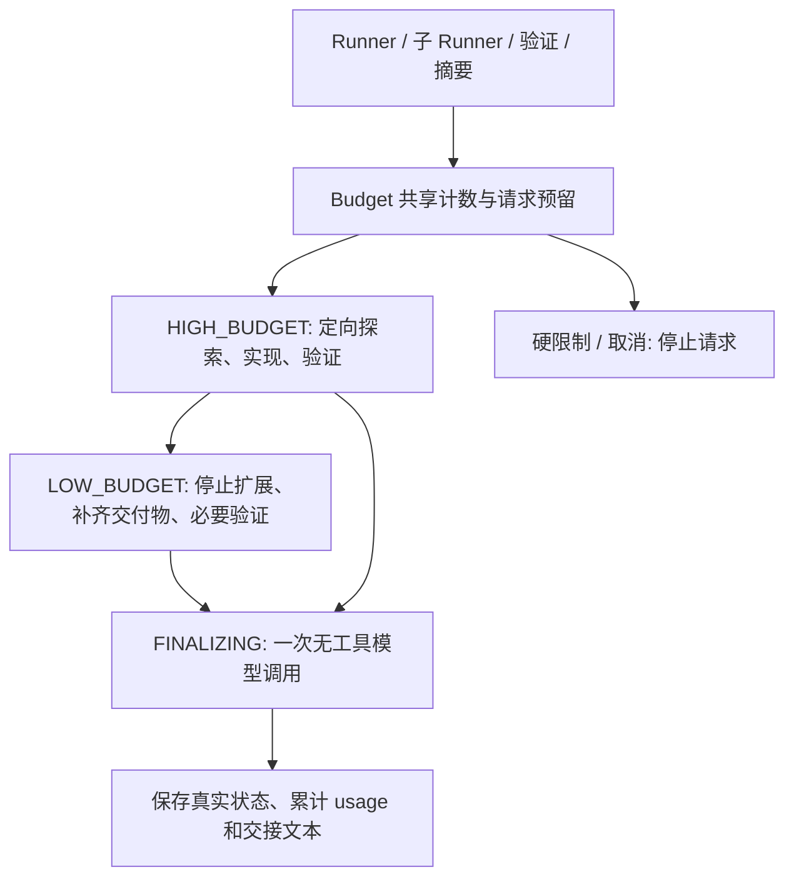

# Budget 预算管理



## 实现

- `harness/budget.py` 的 `Budget` 统一管理工具次数、实际 tokens、在途请求预留、时间、step 进度和阶段；`ChildBudget` 继承管理器，与父级共享锁和取消信号，计费沿祖先链累加，各级上限同时有效。
- `harness/model.py` 在请求前预留估算输入 + 最大输出，返回后按供应商 usage 结算；上下文摘要、子 agent、收尾均走同一入口。估算不是精确 tokenizer；实际返回超限时仍记录 usage，并阻止后续执行。
- `core/loop.py` 每步在 system prompt 中加入当前阶段和剩余资源。阶段只能向前推进。`Runner.finalize` 发送一次不带任何工具定义的请求；即使模型返回工具调用也不执行。它使用有界的真实工具结果，忽略 assistant 的计划性文字；历史完整记录仍保留在 session。
- 同一批工具输出在最近 `repeat_window` 个批次内重复到 context 的 `repeated_batches` 阈值时，进入收尾；提前一次进入 LOW。它能识别 A/B/A/B/A 这类交替重复，但不是通用的语义进展判断器。输出确实变化、分片不同、artifact 路径变化时，可能无法识别。
- 同批工具超过剩余额度时，未启动的调用返回 `budget_limit`，完整记录协议批次，再收尾。已经开始的副作用继续受现有 pending/checkpoint 恢复规则保护。

## 配置与语义

在 `config/harness.local.toml` / example 中统一配置，现有硬上限不变：

```toml
[harness]
low_budget_ratio = 0.35
finalizing_ratio = 0.10
final_input_tokens = 4096
final_output_tokens = 1024
repeat_window = 12
final_step_reserve = 1
```

取 tokens、工具次数、时间、steps 剩余比例的最小值决定 LOW 阶段，子 agent 还受父阶段约束。达到 35% 进入 LOW；tokens、工具或时间剩余 10% 进入 FINALIZING。steps 单独按 `final_step_reserve=1` 预留最后一次调用，不再因只剩 10% steps 提前停止。请求前若剩余 tokens 不足以覆盖约两次当前估算请求，也提前收尾。输入裁剪只发生在收尾的临时上下文中，不改原始 session。

收尾输出上限同时受 `final_output_tokens` 和剩余总额度约束；DeepSeek 与 GPT adapter 都支持本次请求的输出上限覆盖，结束后恢复。没有足够输入额度、时间已耗尽、实际 usage 超过估算或用户取消时，不会额外购买一次请求。这里是提前收敛策略，并不保证所有硬停止都能发出收尾请求。

正常完成仍走原有验证。被迫收尾保留 `budget_limit`、`step_limit` 或 `no_progress`，不会因模型写出总结而改成 completed，也不再运行任何验证工具。预算以当前 run 为范围，恢复 session 会创建新 run 预算；session 的 total usage 仍跨 run 累加。

日志提供 `run_started`（实际硬上限）、`budget_phase_changed` 和 `budget_finalizing`（各维度剩余量及 `phase_reason`）。CLI 启动时显示实际预算，结束时显示阶段触发资源；由 steps 触发的收尾返回 `step_limit`。配置只改变资源策略，不改变工具权限或验收标准。

## 真实编码对比

使用 DeepSeek `deepseek-flash`，同一个标准库 slugify CLI 任务：读取需求，实现函数和 CLI、至少五个 unittest、README，并执行测试。独立审计检查八组输入、CLI、README 和测试数量，不依赖模型自述。

可复现脚本（会调用配置中的真实 API）：

```sh
uv run python evals/budget_comparison.py --output .ajagent/budget-trials/new-run
```

每档独立 workspace，试验配置只引用已有密钥配置，不复制密钥。工具仅文件和代码执行，自动审批仅限该隔离 workspace。详细日志和产物在指定输出目录。

| 档位 | steps / tools / tokens 上限 | 第一轮验收 | 调整后验收 | 调整后实际 input / output | 调整后工具次数 | 结束状态 |
|---|---|---|---|---|---|---|
| tiny | 2 / 2 / 8,000 | 未完成 | 未完成 | 1,815 / 488 | 2 | step_limit，明确交接 |
| small | 6 / 8 / 24,000 | 缺 README | 通过 | 11,154 / 1,312 | 6 | completed，进入 LOW |
| normal | 14 / 24 / 80,000 | 通过 | 通过 | 22,813 / 2,102 | 9 | completed |

第一轮 small 的收尾错误地声称 README 已写入；独立审计发现文件不存在。随后收尾上下文移除了 assistant 计划文字，LOW 提示强调先覆盖全部交付物，高预算提示减少无必要环境检查。另外将试验日志移出项目 workspace，避免 agent 无意义读取自己的日志。第一轮 normal 消耗 31,739 tokens、11 次工具调用，第二轮为 24,915 tokens、9 次。每档仅两次真实运行，而且同时调整了提示和试验布局，因此不能据此声称统计显著的质量或效率提升；证据支持功能可用，也说明仅靠阶段 prompt 不能保证事实正确。

原始结果位于 `.ajagent/budget-trials/live-1/results.json` 与 `live-2/results.json`。最早 `initial` 是试验脚本入口错误，未发出模型请求，不计入编码对比。

设计参考 [Anthropic 的 context engineering 说明](https://www.anthropic.com/research/effective-context-engineering-for-ai-agents)：持续筛选高信号上下文、结构化进度、隔离子任务。三个预算阶段与具体阈值是本项目的实现方案，不是声称复刻 Claude Code 内部算法。

## Snake 日志反馈后的默认额度

runtime 的 max_steps 为 300，harness 的 max_tool_calls / max_tokens / max_seconds 为 900 / 6,000,000 / 3,600；代码回退值与 example/local 配置同步。额度是上限，不是最低运行时长，多个维度中任一项先触发都可能提前结束。输入上下文会在每次请求重复计费，因此长期任务也可能先耗尽 token 额度。调查和复跑见 [Snake 诊断](experiments/snake-budget-diagnosis.md)。
