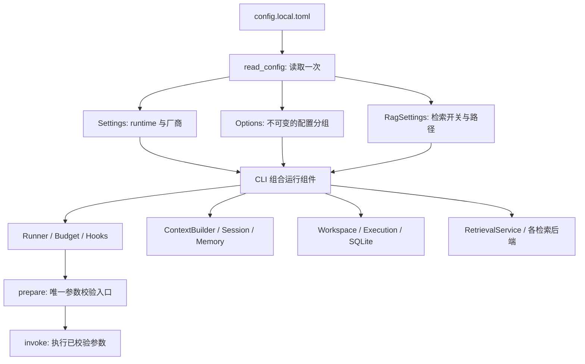

# 配置与模块边界



可调默认值集中在 `src/ajagent/options.py`，使用按职责分组的 dataclass。`DEFAULTS` 是不可变的默认对象，实例通过显式参数接收配置；不同运行不会修改彼此的默认值。模型、路径、厂商凭据及 RAG 开关沿用原有配置结构。

主 CLI 组合加载一次入口及其 TOML 分片，将同一份配置传给 `load_config` 和 `RagSettings.load`；独立的 RAG、memory CLI 各自读取用户指定的配置。没有引入全局可变配置单例。命令行的既有覆盖项继续优先，runtime 的环境变量优先级保持原规则。

## 配置文件

配置现已拆分到 `config/`。入口 `config/config.local.toml` 的 include 加载 runtime、models、tools、rag、harness 分片；MCP 按需单独加载 `config/mcp.local.toml`。完整文件映射、初始化和路径规则见 [配置目录](../config/README.md)。

## 配置分组

| TOML 小节 | 主要内容 | 消费模块 |
| --- | --- | --- |
| `[runtime]` | provider、workspace、步数、请求/工具超时、输出字符预算、context/output token 预算、memory 开关 | config、CLI、loop、模型 |
| `[deepseek]` / `[openai]` | API key、模型、endpoint、协议模式 | 模型适配器 |
| `[harness]` | 工具/token/时间预算、修订轮数、artifact 阈值/预览/读取长度、日志摘要长度、拒绝列表、验证命令 | Runner、Budget、Hooks |
| `[limits.tools]` | 文件大小、扫描数量、读行数、写入/diff 长度、命令参数/输出限额与允许命令、SQLite 上限 | Workspace、Execution、SQLite、Local Search |
| `[limits.context]` | 工具摘录长度、保留批次数、摘要请求余量、token 估算系数、重复调用上限 | ContextBuilder、loop、模型观测器 |
| `[limits.memory]` | 记忆条数、文本/来源长度、session 写入缓冲大小 | Memory、Session |
| `[limits.retry]` | 模型 HTTP 重试次数与退避基数 | HTTPModel；不影响 Tavily 的单次请求策略 |
| `[rag]` | 检索开关、来源、候选数、知识库/索引/缓存路径、rerank、device | RagSettings、检索服务 |
| `[limits.retrieval]` | query/result 上限、RRF、rg 批量、chunk、HNSW、embedding/reranker 批量及长度 | 检索后端与知识库接口 |
| `[tavily]` | API key、超时、search_depth、内容截断长度 | Tavily SDK 适配器 |

`config/*.example.toml` 分组列出当前可调项；对应的 `*.local.toml` 保留本地配置与凭据。省略可调项时使用代码中的统一默认值。修改未知字段、使用无效类型/负数或不一致的上下限会在加载时报错。

例如，只需要调整以下项目时可以写：

```toml
[limits.tools]
max_file_bytes = 2000000
max_scan_files = 2000
command_output_bytes = 16000

[limits.context]
tool_excerpt_chars = 1500
recent_groups = 3

[limits.memory]
max_entries = 30
session_buffer_bytes = 131072

[limits.retrieval]
embedding_batch = 4
reranker_batch = 2
```

配置是覆盖层，不必复制全部默认项。`[rag].candidates` 是粗召回候选数的唯一配置入口，不能大于 `limits.retrieval.rerank_candidates`。`default_results` 不能大于 `result_limit`，后者不能大于 `backend_limit`。默认读行数、SQL 默认行数也不能超过相应最大值。

独立记忆 CLI 支持：

```bash
uv run ajagent-memory --config config/config.local.toml --workspace /path/to/project list
```

程序调用可以使用 `Options.from_config(read_config(path))`，然后将 `options.tools`、`options.context` 等传给相应构造器。`Runner(..., options=options)` 使用其中的 harness 设置；已注入的 workspace/session/builder 仍由调用者按对应配置创建。知识库 `update_knowledge/open_knowledge` 接收 `options=`，省略时读取 `config_path`。

## 索引兼容性

默认参数未变，现有索引仍可打开。改变 chunk 大小、HNSW 建立参数、embedding 维度或截断长度会改变索引兼容性标识；程序会拒绝混用并提示选择新的索引目录。改变 embedding/reranker 的批量大小不要求重建索引。改变 HNSW 查询 ef 只影响查询，不改变已建立的图。

HNSW 建立参数改变后，请用一个新的输出目录重新执行 index，再用 `[rag].index` 选择新索引。程序不会自动删除旧索引。

## 明确的职责边界

- `tools/common/registry.py`：`prepare` 只解析/校验一次；`invoke` 只执行已校验参数并转换异常。普通 `execute` 和 Runner 复用这两个入口。
- `harness/model.py`：记录模型事件与用量、临时附加当前预算；不修改共享 Settings 的 timeout。
- `models/base.py`：唯一负责 HTTP 重试、退避、请求超时和剩余时间的组合。
- `memory/session.py`：`finish` 统一保存 session 累计用量快照；正常、取消、预算耗尽共用相同结束记录格式。
- `core/loop.py`：仍是唯一推理循环，保留模型/工具批次和验证反馈；Runner 不复制循环。
- `cli.py`：解析参数、展示输出和组合组件，交互回调与配置读取分开。

大工具结果由 Runner 写入 artifact，进入 loop 时再按本次输出预算序列化。预览被进一步缩短时保留 artifact 读取路径；过长的错误消息也会有界截断，避免序列化无法结束。session 的原始记录不会因为输入裁剪而覆盖。

不是所有数字都应成为参数：HTTP 状态码、协议字段、JSON 缩进、数组索引、算法计数和模型固定 revision 属于实现或兼容性约定。Tavily 最大返回条数、Qwen 维度边界等保留为明确命名的协议常量，不作为任意可调项。Stage 1 的独立最小示例保留其教学结构，不依赖完整配置框架。

## 统一工具配置

所有工具组只由 `[tools]` 开关控制；配置与完整范例见 [Tools README](../src/ajagent/tools/README.md)。

```toml
[tools]
enabled = ["files", "database", "execution", "web", "skills", "delegation", "artifacts"]
disabled = []
skills_path = "../skills"
mcp_config = "mcp.local.toml"
```

可追加的工具组为 `retrieval`、`browser`、`mcp`。`disabled` 排除具体工具名，也传递到子任务。所有能力参数与启用状态分开：RAG 参数继续在 `[rag]`，MCP server 参数放单独的 `config/mcp.local.toml`，超时/大小/并行数放 `[limits.capabilities]`。

原 `--rag`、`--rag-*`、`--browser`、`--mcp-demo` 和 `[rag].enabled` 已移除。迁移方式：在 enabled 添加相应组；RAG 路径写 `[rag].index/local_path`，来源写 `[rag].sources`；`limits.extensions` 改名为 `limits.capabilities`。本项目 example/local 配置已迁移，密钥与模型选择保留。独立的知识库构建 CLI 参数不变。

| 能力参数 | 默认 | 含义 |
| --- | --- | --- |
| fetch_timeout / fetch_bytes | 15 秒 / 2000000 字节 | 网页抓取限制 |
| text_chars / url_chars | 12000 / 2000 | 正文和 URL/selector 上限 |
| browser_timeout | 10 秒 | 页面操作超时 |
| skill_bytes / skill_metadata_chars | 32000 / 1000 | skill 正文和 metadata 上限 |
| read_workers / subagent_workers | 4 / 3 | 只读批次、并行子任务上限 |
| child_steps / child_tool_calls | 5 / 10 | 子任务独立步数、工具上限 |
| child_tokens / child_seconds | 30000 / 120 秒 | 子任务预算，同时受父级约束 |
| task_chars / summary_chars | 8000 / 4000 | contract 文本字段、返回摘要上限 |
| max_proposals | 10 | 单子任务提案上限 |
| researcher_tools / reviewer_tools | 见模板 | 子任务可继承的只读工具名 |
| mcp_timeout | 10 秒 | MCP server 未覆盖 timeout 时的默认超时 |

MCP 完整配置、持久连接及 HTTP 认证说明见 [MCP README](../src/ajagent/tools/mcp/README.md)。模型不能通过工具启用新 server；配置启用本地 server 表示允许启动该程序，具体工具仍按 read/execute 策略处理。

浏览器仍为可选依赖；加入 enabled 后使用同一浏览器安装路径：

```bash
uv sync --all-extras
export PLAYWRIGHT_BROWSERS_PATH=0
uv run --all-extras playwright install chromium
uv run --all-extras ajagent '打开本地演示网页并读取正文'
```

本次 Chromium 安装在 .venv 内。也可以使用 Playwright 默认用户缓存，但安装和运行应保持一致。运行时保留需要的 extras，避免 uv 移除未选中的可选依赖。
