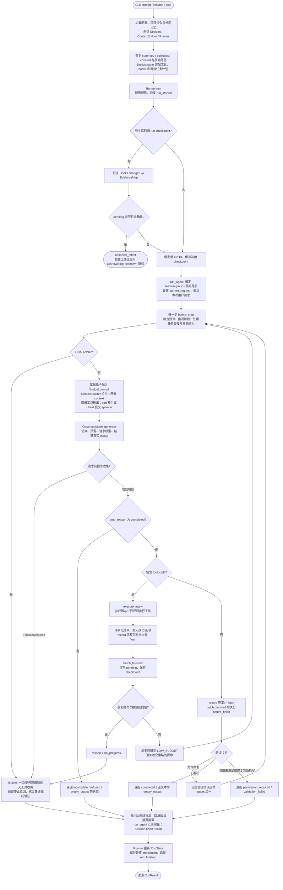
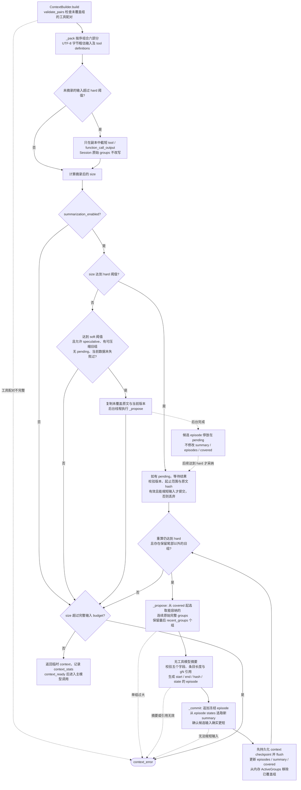
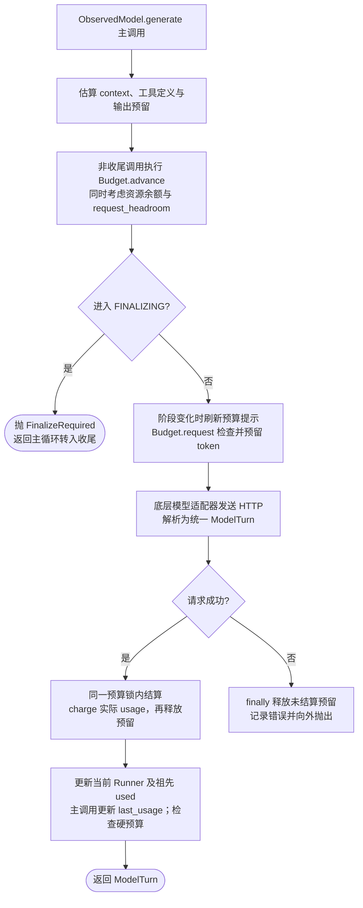
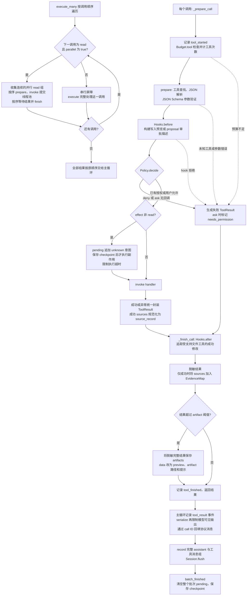
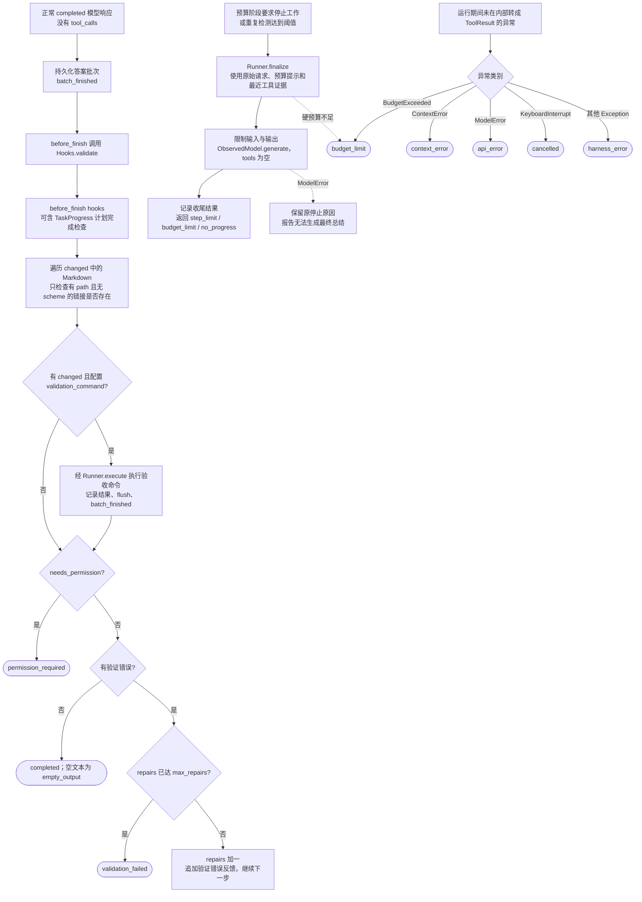
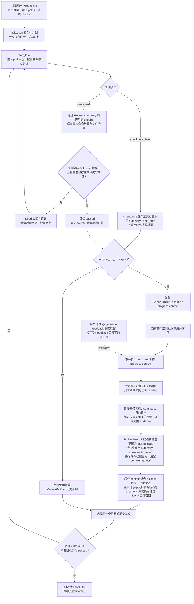
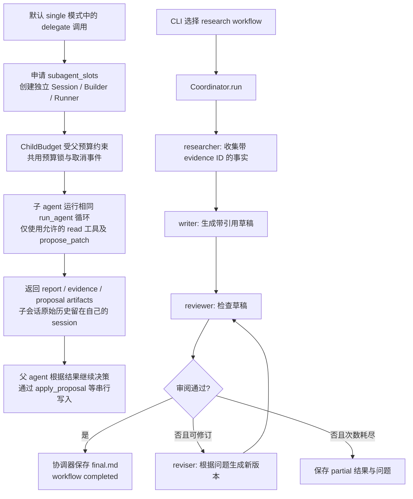

# Agent 执行流程（对照当前实现）

本文以默认 `single` 模式的 `Runner.run()` 为主线。模型决定下一步做什么；`run_agent()` 维护模型与工具交互循环；`Runner` 提供预算、权限、调度、验证、恢复与持久化能力。可选的固定 research workflow 另见第 7 节。

## 1. 对原流程总结的补充与修正

| 环节 | 当前代码的准确行为 |
| --- | --- |
| 恢复来源 | Session 的 JSONL 保存未被上下文压缩覆盖的完整协议 groups；可重建的 HistoryIndex 增量索引日志。恢复时校验 context checkpoint，有效则只加载 covered 之后的原始尾部到内存，并恢复 summary/episodes/covered；无效则回退原始历史。Runner 再读取关联 run 的 checkpoint 检查副作用。 |
| 新 run 与预算 | `Runner.__init__()` 创建 `Events` 时就生成新的 run ID；恢复检查通过后才把它绑定到 session。正常 CLI 恢复会创建新 Runner/Budget，运行预算重新开始，session 累计用量保留。 |
| 未知副作用 | pending 表示上次没有完成整个工具消息批次的持久化，副作用可能已发生。缺少 `--acknowledge-unknown` 时返回 `unknown_effect`；确认后继续，不自动重放旧调用，也不据此证明上次成功。 |
| 预算阶段 | 正确名称是 `HIGH_BUDGET → LOW_BUDGET → FINALIZING`，只向前推进。`advance(step)` 综合 token、工具次数、时间和步数；模型请求前再加入本次请求大小判断，不是前者只看 step、后者只看 token。 |
| 系统提示词 | 每步创建 `active_system = system_prompt + Budget.prompt()`，不反复修改基础 system_prompt；因此预算提示不会逐步重复累加。 |
| 上下文组成与压缩 | context 按序组合 system prompt、episode 目录、summary、必要时补入的最近 user group、本次 current_request 和未覆盖的 recent groups；达到 soft 阈值可后台生成候选 episode，达到 hard 阈值才采纳或同步压缩，不必等到输入真正超限。 |
| 任务上下文交接 | `TaskProgress.checkpoint()` 保存模型传入的 summary/next_step，再设置延迟交接；`verify_task` 通过后也可触发。下一步由 `builder.handoff()` 归档覆盖范围、持久化任务工作状态并移除内存旧尾部，不额外调用摘要模型。 |
| 模型结果 | 必须先检查 `stop_reason == completed`。incomplete/refused/empty_output 等直接结束，不执行该响应里的工具，也不进入普通完成验证。 |
| 权限 | read 通常直接允许，但 deny 优先；write/execute 仅在没有自动批准或已保存授权时询问。未配置交互回调时返回 permission_required 工具错误，正常答案路径最终会被同名状态拦截。 |
| 并行条件 | 仅连续的 `effect == read AND parallel == True` 工具组成并行组。其他调用都是串行屏障；结果始终按原调用顺序回填。delegate 默认符合并行条件，task_status 则显式禁止并行。 |
| changed 与 evidence | 内置 changed 追踪成功的 write_file/apply_proposal/restore_file；不会自动发现任意命令修改的所有文件。`EvidenceMap.add()` 只接收成功工具的 sources，规范化并去重，来源记录本身不证明结论正确。 |
| 完成验证 | 除 Markdown 本地链接外，还执行 before_finish hooks（包括任务计划完成检查），有 changed 且配置了 validation_command 时执行验收命令。失败最多反馈修复 max_repairs 次，之后 validation_failed。 |
| 重复检测 | signature 包含工具名、规范化参数与序列化结果，并排序、排除 call ID。默认最近 12 个批次中同一 signature 第 2 次触发低预算提示，第 3 次立即无工具收尾，状态 no_progress；不要求连续重复。 |
| 最终收尾 | finalize 使用原始请求、预算提示和能容纳的最近完整工具证据，不纳入 assistant 计划文字，不携带工具；绕过普通 before_finish 验证，保留 step_limit/budget_limit/no_progress 原因。硬预算或时间耗尽可能无法再请求收尾。 |

默认值来自 [options.py](../src/ajagent/options.py) 的 ContextOptions 与 HarnessOptions，可被配置覆盖。主流程依据 [loop.py](../src/ajagent/core/loop.py) 的 run_agent / _run_agent 和 [runner.py](../src/ajagent/harness/runner.py) 的 Runner.run。

## 2. 启动、恢复与主循环总览

图中 `J → … → J` 受 `for step in range(1, max_steps + 1)` 限制。默认在最后一步进入 FINALIZING；若循环自然耗尽，直接返回 step_limit。预算检查还可能抛出硬限制异常，处理见第 5 节。

启动依据 [cli.py](../src/ajagent/cli.py) 第 76、99 行、[session.py](../src/ajagent/memory/session.py) 第 12 行、[ToolManager](../src/ajagent/tools/runtime/loader.py) 第 38 行；主循环见 [loop.py](../src/ajagent/core/loop.py) 第 21、88 行。

## 3. 上下文构建与每次模型调用

### 3.1 Session 原始历史与 context 的六部分

Session 将 `record()` 收到的完整协议组追加到 JSONL；上下文压缩不会用 summary 或工具摘录覆盖这些 messages。`session.groups` 是内存中的 ActiveGroups，可在提交压缩后移除 covered 之前的旧组；`group_count = groups.start + len(groups)` 仍表示整个会话的组数。旧原文通过 history_search / history_read 按 gN 召回，HistoryIndex 的 SQLite 文件只是可重建索引。

`_pack()` 按以下顺序构建模型输入；六部分按条件出现，不是每次固定六条消息。

| 顺序 | 部分 | 实际内容与加入条件 |
| --- | --- | --- |
| 1 | system prompt | 当前系统指令，主循环每步加入 Budget.prompt。 |
| 2 | episodes | 最近 visible_episodes 个冻结 episode 的目录：group 范围、hash、简短 hint；不是把所有 episode 的完整 state 都放进 context。 |
| 3 | summary | 可变工作状态。普通压缩提交时，从所有冻结 episode.state 按 goals、constraints、decisions、progress、open_questions 各选取最后 state_entries 条记录，确定性地构建 JSON；任务 handoff 时可替换为持久任务状态文本。 |
| 4 | last user prompt | 当前传入 groups 中最后一个以 role=user 开头的组；仅当它已落入 covered 范围、否则会被尾部排除时单独补入。它也可能是补充输入或验证反馈。 |
| 5 | current user prompt | builder.current_request，即本次 run 的请求；如果前缀和未覆盖尾部已包含完全相同的 user 消息，则不重复添加。 |
| 6 | recent groups | covered 之后尚未归档的完整协议组，复制后展平为消息；必要时只在副本上截短工具结果。recent_groups 配置是压缩时必须保留的尾部组数，不是每次只发送这么多组。 |

`covered` 是已经归档的绝对组数，也是下一段待压缩原文的起点；episode 的 start/end 为零基半开区间，引用 gN 使用从 1 开始的稳定编号。输入估算同时计算 context 与工具定义，输入上限为 `max_tokens - output_tokens`。

实现依据：[session.py](../src/ajagent/memory/session.py) 第 12、69 行、[history.py](../src/ajagent/memory/history.py) 第 14、31 行、[builder.py](../src/ajagent/context/builder.py) 第 123、132 行。

### 3.2 工具摘录、soft 预生成与 hard 提交

- 默认 soft_ratio=0.80、hard_ratio=0.95。每次 `_pack()` 先在未摘录输入超过 hard 阈值时缩短工具输出，build 再按摘录后的 size 判断 soft/hard；因此不是等到整个 budget 超限才开始压缩。
- soft 分支不等待候选，也不采纳已经完成的候选。hard 分支才等待并尝试提交；新增或修改未被候选覆盖的尾部不会使它自动过期，候选覆盖原文的 hash 或工作状态版本变化才会使其失效。
- `_propose()` 只摘要尚未覆盖的原始 groups，不把旧 summary 或已冻结 episode 再交给模型。单次摘要输入受限，hard 路径可能连续提交多个 episode，并非只尝试一次，也不保证一次就能覆盖全部较旧 groups。
- episode.state 必须包含 goals、constraints、decisions、progress、open_questions 五个数组；每条记录包含 text 与真实输入组的 refs。`_commit()` 比较压缩前后的输入大小，持久化成功后才推进 covered 和移除内存旧组。
- 后台失败或过期的候选被丢弃并记录诊断；hard 路径可继续同步尝试。关闭摘要或没有可压缩旧组时，只有最终输入仍超过完整 budget 才返回 context_error。原始日志始终保留。

实现依据：[builder.py](../src/ajagent/context/builder.py) 第 132、164、185、197、216 行、[compaction.py](../src/ajagent/context/compaction.py) 第 17、34、46 行。

### 3.3 主模型与摘要调用的预算记账

- 摘要使用独立的 `ObservedModel.generate_summary()`：复制模型适配器、限制摘要输出、不携带工具，经 Budget.request 预留与结算同一运行预算；不走主调用的 Budget.advance，也不覆盖 last_usage，便于后台与主请求并发。
- 即使摘要格式无效、候选过期或最终未提交，已经收到模型 usage 的请求仍计入 used 和 builder.usage。退出 run 前先 close 压缩线程池、等待已运行请求结算，再保存累计用量；未提交的候选会丢弃。
- HTTP 层只重试请求本身：网络错误、429、5xx 按策略退避重试；不会重跑整个 step，也不会重放工具副作用。错误最终返回 api_error。
- `Budget.request()` 的 settle 在锁内先计入实际用量、再释放估算预留；异常退出只释放预留，没有可用 usage 时不会凭空记账。
- 图中的正常调用先执行 advance；finalize 已设置 finalizing 标记，会跳过再次要求收尾的判断，但仍受 request/check 约束。

实现依据：[harness/model.py](../src/ajagent/harness/model.py) 第 17、37 行、[builder.py](../src/ajagent/context/builder.py) 第 246 行、[loop.py](../src/ajagent/core/loop.py) 第 31 行、[budget.py](../src/ajagent/harness/budget.py) 第 135 行。

## 4. 工具调度、权限、副作用与结果

调度规则：连续的可并行 read 一组一组执行，遇到其他工具就等待前一组并串行执行。prepare 和 finish 按原调用顺序执行，只有 invoke 进入线程池。delegate 还受 subagent_slots 限制。

权限按以下顺序生效：deny 优先；否则 read、auto_approve_tools、会话 allow_all、已保存 scoped grant 可直接允许；其余需要用户 once/session/allow_all 授权。write 的 scope 是工具名与 path，execute 使用完整参数。等待审批时先记录 waiting_for_user 并保存 checkpoint；授权决定返回后恢复 running。

pending 不在单个调用结束后删除。即使前面的写入已成功，后续调用中断导致完整消息批次未落盘，恢复时仍按 unknown_effect 处理。它保护的是“副作用与可重放消息批次之间的边界”，不代表文件工具有事务回滚。

输出限制有三层：Runner 将长结果保存为 artifact 并返回摘录；serialize 限制发给模型的 JSON 大小；ContextBuilder 在后续未摘录输入超过 hard 阈值时缩短历史观察。第三层只修改临时副本，摘录前的协议组在 session 日志中，不意味着每次上下文截断都会新建 artifact。

EvidenceMap 的记录包含 id、uri、kind、title、locator，并保留原有 path/line 等字段；id 根据 kind、uri、locator 生成，用于去重。命令工具的 `ok=True` 只表示调用成功，还需看 exit_code 判断进程是否成功。

实现依据：[runner.py](../src/ajagent/harness/runner.py) 第 153、205、230 行、[policy.py](../src/ajagent/harness/policy.py) 第 18 行、[registry.py](../src/ajagent/tools/common/registry.py) 第 15、37、60 行、[evidence.py](../src/ajagent/tools/common/evidence.py) 第 6 行。

## 5. 完成验证、预算收尾与异常退出

正常结束时 run_agent 先关闭后台压缩线程池、结清已运行摘要的用量，再将本次主模型、摘要与所有子 agent 的实际 used 汇总一次，加上 session 旧累计用量，保存 Session.end。Runner 随后更新 RunState、保存 checkpoint、发出 run_finished。BudgetExceeded/KeyboardInterrupt/其他异常由 Runner 外层生成结果并保存会话；unknown_effect 则在进入循环前提前返回。

| RunResult.status | RunState.status |
| --- | --- |
| completed | completed |
| cancelled | cancelled |
| permission_required / unknown_effect | waiting_for_user |
| 其他停止原因 | failed |

收尾内容即使写得完整，status 仍保留停止原因；不能把收尾输出等同于任务通过验证。任意硬限制也不保证还能发起最后一次模型请求。

实现依据：[runner.py](../src/ajagent/harness/runner.py) 第 102、261、281 行、[hooks.py](../src/ajagent/harness/hooks.py) 第 26 行、[state.py](../src/ajagent/harness/state.py) 第 11 行、[loop.py](../src/ajagent/core/loop.py) 第 21、71 行。

## 6. 长任务、验收、反馈与延迟上下文交接

这里的 summary 是工作进度数据，包含模型已写下的摘要，不是第二次 LLM 压缩。`builder.handoff()` 为新覆盖范围增加 kind=task、state 为空的 episode，再保存任务状态；这也会改变工作状态版本，使旧后台压缩候选在尝试采纳时失效。`context()` 在下一次 before_step 才读取反馈，因此能带入 checkpoint 之后、交接之前新提交的反馈；不会每一步自动监听反馈目录。

`Feedback.list()` 读取 `.ajagent/tasks/<task_id>/feedback/*.json`，不是任意手写文本文件。pending 与 accepted 反馈均可进入任务上下文；只有显式 accept-feedback 才写入长期 Memory，rejected 反馈不进入交接上下文。

`--resume SESSION_ID` 恢复历史会话；`--task TASK_ID` 默认创建新会话，以持久任务状态重新开始上下文。TaskProgress.bind 还会关联任务记录的旧 run，继续检查未知副作用。新会话初次加载任务时，ToolManager 已将 context() 加入系统指令。

实现依据：[progress.py](../src/ajagent/tasks/progress.py) 第 28、97、152、160、203、210 行、[feedback.py](../src/ajagent/tasks/feedback.py) 第 20 行、[loader.py](../src/ajagent/tools/runtime/loader.py) 第 67 行、[Runner.before_step](../src/ajagent/harness/runner.py) 第 85 行。

## 7. 可选子 agent 与固定 research workflow

这两种机制分别是主循环里的一个工具和 CLI 选择的外层工作流。

- delegate 默认禁止继续嵌套委派；子 agent 只能产生分析或 proposal artifact，主 agent 才能修改工作区。多个同批 delegate 调用可并行，used 向父 Runner 汇总。
- research 模式的每个角色也复用 Runner。节点有独立的结构化输出/证据校验及有限重试，外层协调器负责版本与发布。该模式不经过父 Runner.run 的单主循环入口，CLI 明确不支持 research 配合 --resume/--task。

实现依据：[delegation/agent.py](../src/ajagent/tools/delegation/agent.py) 第 18 行、[coordinator.py](../src/ajagent/multi_agent/coordinator.py) 第 30、74 行、[cli.py](../src/ajagent/cli.py) 第 83、140 行。

## 8. 持久化数据与恢复职责

| 路径 | 内容与用途 |
| --- | --- |
| `.ajagent/sessions/<session_id>.jsonl` | 未被上下文压缩覆盖的完整可重放 messages 组（含 gN 编号）、授权、context checkpoint、task/run 关联及累计 usage；context checkpoint 保存 format、summary、episodes、summarized_groups、prefix_hash，context_stats 仅保存每步统计。完整消息组与压缩提交立即 flush。 |
| `.ajagent/sessions/<session_id>.history.sqlite` | JSONL 的可重建增量索引：原始 groups、元数据、前缀哈希链与搜索索引；支持 history_search/history_read，恢复时校验 checkpoint 并只加载未覆盖尾部。不是压缩后的历史替代品。 |
| `.ajagent/runs/<run_id>/checkpoint.json` | state、completed_step、pending、changed、会话绝对 group_count、session usage、evidence；通过临时文件替换。恢复只取需要的 changed/evidence/pending，不续用旧运行预算或旧步数。 |
| `.ajagent/runs/<run_id>/events.jsonl` | 模型、工具、权限、预算阶段、压缩、验证与结束事件；trace 读取它而不重新执行。 |
| `.ajagent/runs/<run_id>/artifacts/` | 超长工具结果、子任务 report/proposal、可选 workflow 版本；read_artifact 可按 offset/length 读取受限片段。 |
| `.ajagent/tasks/<task_id>/tasks.json` | 长任务唯一权威状态：目标、active、summary、next_step、状态、验收证据与文件哈希。 |
| `.ajagent/tasks/<task_id>/checkpoints/` | 长任务每个 revision 的快照；区别于 run 的副作用 checkpoint。 |
| `.ajagent/tasks/<task_id>/progress.md` | 供人查看的任务进度投影。 |
| `.ajagent/tasks/<task_id>/feedback/` | 用户反馈 JSON；接受后才另写长期记忆。 |

两种预算需要分清：ContextBuilder 的预算约束单次输入能否放进模型上下文；Budget 的限额约束整个 run 和它的子 agent 的资源使用。二者的超限分支分别可能产生 context_error 与 budget_limit。
