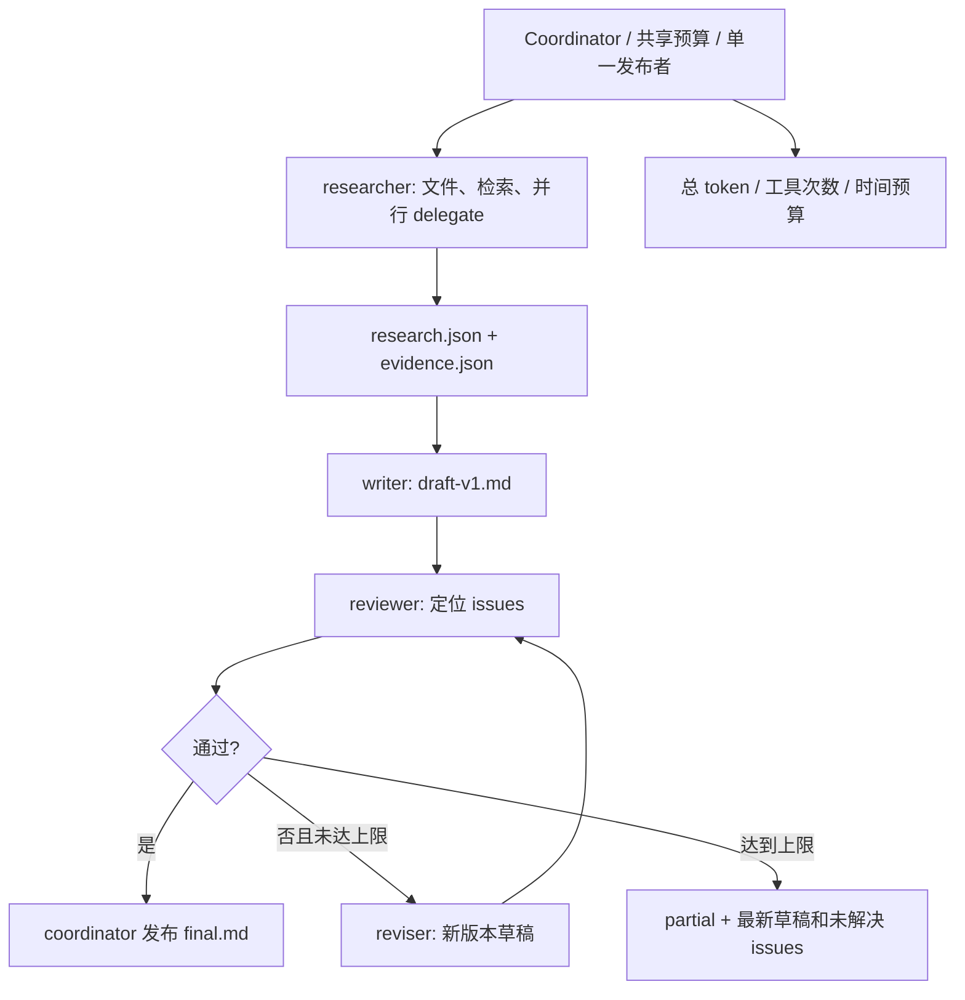

# 多 agent 协调



这是一个确定性状态流程，节点仍使用现有 Runner 和唯一的 run_agent 循环，不是第二套 agent SDK。角色独立思考，但路由、终止与发布由 Python 决定。

## 使用

```sh
uv run ajagent --workflow research '阅读 README.md 和 docs/architecture.md，撰写项目设计说明并审阅引用'
uv run ajagent --workflow single '普通任务'
```

`config/coordination.local.toml` 的 `enabled = true` 可将协作设为默认；CLI workflow 仅覆盖本次模式，不改变工具开关。工具仍统一由 `config/tools.local.toml` 控制，角色 tools 只进一步裁剪已启用的 read 工具。writer/reviser 默认没有外部工具，输出 JSON 草稿后由 coordinator 落盘，避免多角色覆盖文件。

默认角色沿用主模型。可设置 `[coordination.roles.reviewer] provider = "openai"`，model 省略则读取该厂商的配置；显式 model 优先。只能选择 DeepSeek 或 OpenAI。角色 Markdown 位于根目录 `agents/`，路径可通过 roles_path 调整。

配置上限：max_revisions 为 0–2；node_retries 为 0–1；node_steps 控制各角色单次 Runner 的步数。所有节点、节点重试、研究子任务共享父级预算，不能用重试重置总额度。最后一次请求用量和整个任务累计用量分别保留。

## 模块

- `roles.py`：配置校验、提示词读取、独立 Session/ContextBuilder/Runner、只读工具裁剪、证据捕获。角色继承项目指令，但不继承主会话历史或长期问候等对话偏好。
- `handoff.py`：显式 task_id、goal、inputs、evidence_ids、artifact_paths、acceptance_criteria、remaining_budget；JSON 解析及按角色校验。重复 claim 合并证据 ID，语义冲突由 researcher 明确列出并交 reviewer 核查。
- `coordinator.py`：有界顺序路由、失败反馈、版本化产物、单一最终发布者。空研究、伪造证据 ID、空草稿、无定位 review 或不一致 pass/issue 会失败；最多重试一次，仍失败返回 partial。
- `runtime.py`：复用配置和双厂商适配器的组合入口。

研究节点可使用已启用的 delegate 一次发出多个 task contract，由现有调度器并行运行。只有 coordinator 创建的研究节点获得这一层委派授权；worker 不注册 delegate，不能继续递归。worker 的 proposal 只是 artifact，本流程不向任何角色提供 apply_proposal 或文件写入工具。

## 证据与产物

每次工具观察以来源 URI/locator 生成稳定 ID。researcher 使用 evidence_catalog 获取实际 ID；只有本节点真正观察到的来源能进入 research handoff。观察内容按工具输出预算截断并脱敏，随后固定交给 writer/reviewer/reviser。delegate 的证据包含子任务报告摘要，不复制整个子任务 transcript。

引用格式 `[e:ID]`。draft 中的 ID 必须存在于 evidence.json；通过后 final.md 附带来源定位表。**ID 可追溯只保证来源身份，不能证明语义支持**：语义检查依赖独立 reviewer，仍可能误判。资料不足时返回 partial，不自动联网补充或无限修订。

产物在 `.ajagent/runs/<id>/artifacts/`：

```text
researcher-v1-attempt1-handoff.json  # 输入契约与剩余预算
researcher-v1-attempt1-response.json # 角色结果、usage 与子 run ID
research.json / evidence.json
draft-v1.md / review-v1.json
draft-v2.md / review-v2.json         # 按需修订
final.md                           # 仅 review 通过后生成
result.json                        # 状态、原因、失败、最后 review 与用量
```

失败保留已有草稿和审阅意见。角色输出不能自行产生 final.md。取消/预算耗尽不会发布成功；HTTP 请求受既有剩余时间约束。固定 workflow 不支持 `--resume` 或 `--task`；需要持久恢复时使用默认主 agent 的 task 功能。

## 验证与参考

`uv run pytest tests/test_coordinator.py -q` 覆盖失败→修订→通过、空证据、引用与契约错误、有限重试/修订、取消、共享预算和研究并行委派边界。


参考 [Claude Code subagents](https://code.claude.com/docs/en/sub-agents) 的独立上下文、指定工具与模型设计；角色链、JSON 合同和单一发布者是本项目的简化实现，不代表 Claude Code 内部核心实现。
