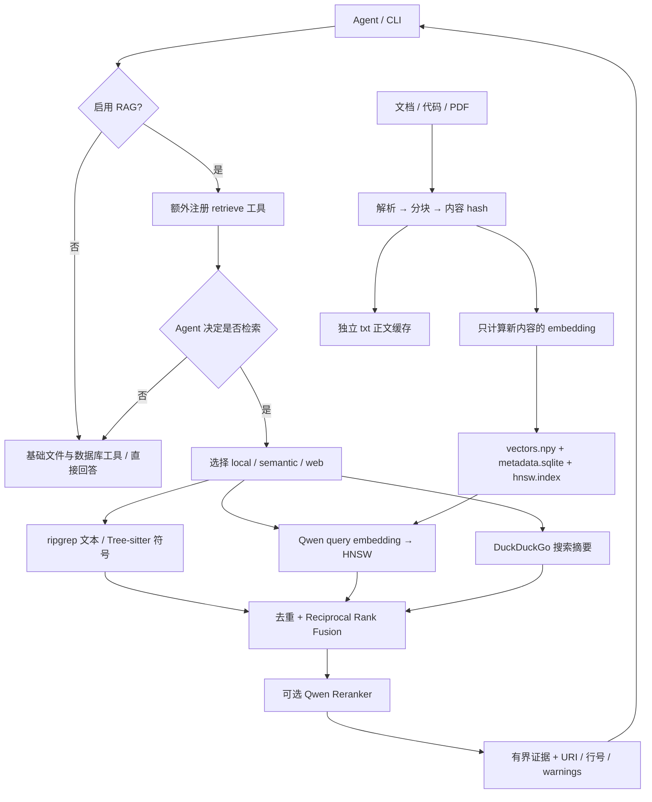

# RAG：可选的统一检索工具



RAG 是一个工具能力，不是回答的必经步骤。默认 `ajagent` 不注册 `retrieve`；`--rag` 或 `[rag].enabled=true` 才开启。开启后原有文件/数据库工具仍可用，模型可以不调用检索直接回答。生成模型仍仅用 DeepSeek 或 GPT；embedding 和 reranker 在本机运行，不使用厂商 Agent SDK，不需要 OpenAI embedding key。

## 目录与职责

```text
rag/
├── README.md
├── types.py                 # Hit、SearchResult 的统一契约
├── device.py                # auto / CPU / CUDA / MPS 与推理精度
├── service.py               # 配置、按需组装、结果融合与 rerank
├── cli.py                   # 独立 index/search 命令
├── local/
│   ├── search.py            # rg 字面量/正则搜索、AST 符号搜索
│   └── syntax.py            # Python / JavaScript / TypeScript / TSX AST
├── semantic/
│   ├── chunks.py            # PDF 提取、文档章节和代码定义分块
│   ├── encoder.py           # Qwen3-Embedding-0.6B
│   └── store.py             # 增量写入、快照发布、HNSW 查询
├── web/
│   └── search.py            # 搜索引擎适配、URL 去重、短期缓存
├── ranking/
│   └── qwen.py              # Qwen3-Reranker-0.6B
```

`tools/retrieval.py` 将 service 适配成现有 `ToolSpec`。当前索引为 `.ajagent/rag-index`，配置统一使用 `[rag]`。

## 安装与运行

```bash
# 基础检索依赖。系统还需安装 rg，例如 macOS 的 brew install ripgrep。
uv sync --locked
uv run ajagent-rag search 'run_agent' --sources local --mode symbol --no-rerank
uv run ajagent-rag search 'max_steps' --sources local --glob '*.py' --no-rerank

# 本地模型依赖；首次运行下载两个固定版本的 Qwen 权重。
uv sync --locked --extra local-models
uv run --extra local-models ajagent-rag index
uv run --extra local-models ajagent-rag search 'Orion v2 的缓存保留多久？' --sources semantic
uv run --extra local-models ajagent --rag 'Orion v2 的缓存保留多久？请引用依据。'

# Web 默认未开启；明确选择才会把查询发给搜索引擎。
uv run ajagent-rag search 'Qwen3 Embedding' --sources web --no-rerank
uv run --extra local-models ajagent --rag --rag-sources local,semantic,web '检索与问题相关的资料'

# 关闭 RAG，或仅用无需模型的本地搜索。
uv run ajagent --no-rag '你好'
uv run ajagent --rag --rag-sources local --no-rag-rerank '查找 run_agent 的定义'
```

`index` 只做本地模型推理，不调用聊天 API。默认扫描工作目录下 `examples/knowledge`，可用 `--knowledge docs --index .ajagent/docs-index` 改变；查询时使用相同 `--index` 和 `--knowledge`。模型缓存放在 `.ajagent/models`，默认 `auto` 按 CUDA → MPS → CPU 选择设备，也可显式配置 `cpu`、`mps`、`cuda` 或 `cuda:0`。首次下载需要网络和数 GB 磁盘；缺少依赖/模型时会报错或在部分结果中给出 warning，不会用随机向量替代。

启用本地模型的命令始终带 `--extra local-models`，避免 uv 的依赖同步移除可选包。只使用 Local/Web 且关闭 rerank 时不加载 torch 或模型权重。默认开启 rerank，因此即使只搜索 Local，也应带模型 extra 或明确关闭 rerank。

## 配置

把下面的小节按需添加到已有 `config.local.toml`，不要覆盖厂商 key。CLI 显式参数优先于本节；RAG 没有单独的环境变量覆盖规则。

```toml
[rag]
enabled = false
sources = ["local", "semantic"]
knowledge = "examples/knowledge"
index = ".ajagent/rag-index"
cache = ".ajagent/models"
rerank = true
device = "auto"
candidates = 10
```

路径以 workspace 为基准；`--config` 以当前命令目录为基准。`knowledge` 必须在 workspace 内。agent 参数是 `--rag` / `--no-rag`、`--rag-sources`、`--rag-rerank` / `--no-rag-rerank`。独立检索 CLI 的对应参数是 `--sources`、`--rerank` / `--no-rerank`。

### GPU 加速

embedding 和 reranker 共用 `[rag].device`。`auto` 优先 CUDA，再选可用 MPS，否则 CPU；设备在首次加载模型时确定。CUDA 使用 FP16 权重/推理，CPU 和 MPS 使用 FP32；embedding 归一化及 reranker softmax 转为 FP32，保存的向量仍为 float32。只换设备无需重建索引，但浮点精度差异可能轻微影响排序。

在 3080 Ti 所在的机器上，需要安装能识别 NVIDIA 驱动的 CUDA 版 PyTorch。先验证实际环境：

```bash
uv run --extra local-models python -c "import torch; print(torch.__version__, torch.version.cuda, torch.cuda.is_available())"
uv run --extra local-models python -c "from ajagent.rag.device import inference_device; print(inference_device('auto'))"
uv run --extra local-models ajagent-rag search 'Orion v2 的缓存保留多久？' --sources semantic
```

若希望 CUDA 不可用时明确失败，设 `device = "cuda"`；service 会把后端失败作为 warning 返回，直接 index 命令会报错。不会在显式指定设备或 GPU 显存不足时偷偷回退 CPU。当前执行环境未检测到 CUDA/MPS，真实推理验证为 CPU；CUDA/MPS 选择和模型加载参数有 mock 测试，3080 Ti 实际运行仍需在对应机器验证。GPU 推理是可用路径，不承诺所有短查询都比 CPU 更快。

设备检测依据：[PyTorch CUDA availability](https://docs.pytorch.org/docs/stable/generated/torch.cuda.is_available.html)、[MPS backend](https://docs.pytorch.org/docs/stable/notes/mps.html)。

## 1. Local Search

- `mode=text`：`rg --fixed-strings`，大小写不敏感。适合文件名以外的精确字符串、配置键、错误信息。
- `mode=regex`：ripgrep 正则；非法表达式作为工具错误返回。
- `mode=symbol`：Tree-sitter 定位类、函数、方法、箭头函数；支持 `.py/.js/.jsx/.ts/.tsx`。名称按子串匹配，返回符号类型和行号；装饰器/导出语句尽量包含在范围内。
- `glob` 限定扫描文件。语法错误会提示改用文本搜索；其他语言仍可用 rg。
- 沿用 Workspace 路径策略，排除隐藏文件、本地配置、链接。最多扫描 1000 个文件，每个最多 1 MB；文本每文件最多 5 条匹配，长行由 rg 限制；AST 摘要最多 4000 字符。默认执行时间预算 5 秒。它是有界候选召回，不是所有匹配的完整枚举。

## 2. Semantic Search

### 解析与 chunk

支持 Markdown、TXT、RST、PDF 以及上述代码类型。Markdown 以章节标题为边界，保留标题 metadata；其他正文按行拼接为有界片段。代码使用 AST 定义起止边界，覆盖类/方法/函数与定义之间的全局代码，避免为整个类和每个方法重复保存完整正文。损坏代码退回文本分块。单片上限 1800 字符，超长行继续切分，不以字符数冒充 token 数。

PDF 使用 pypdf 一次提取文本，随后像普通文本一样分块；不做 OCR。PDF 的行号是**提取后文本的行号**，不是 PDF 页码/视觉行号。当前未做表格重建、图片理解、DOCX/HTML 解析、多语言 AST 全覆盖。

### Embedding

固定模型 `Qwen/Qwen3-Embedding-0.6B` 的 commit revision。query 加检索任务指令，文档不加；左 padding，取最后 token 的 hidden state，截取维度后 L2 normalize。输出默认 1024 维 float32，推理 batch 8，输入最多 1024 tokens。模型类支持 32–1024 维，但当前 CLI 固定默认维度；改变模型、维度、来源目录或 chunk 版本需选择新索引目录，避免混合向量空间。

### 存储与增量算法

```text
.ajagent/rag-index/
├── CURRENT                       # 原子替换的当前 generation 名称
├── LOCK                          # Unix flock，串行化 writer
├── texts/<content-sha256>.txt     # 独立正文；相同内容共用
└── gen-<uuid>/
    ├── vectors.npy               # float32；HNSW label 就是向量行号
    ├── metadata.sqlite           # docs、chunks、settings；不保存正文
    └── hnsw.index                 # cosine，M=16，ef_construction=200
```

1. 扫描知识目录并计算文件 hash；未变文件不解析、不 embed。
2. 新/变更文件解析并分块。按完整 chunk 内容 hash 复用向量，包括文件移动与旧版本复用。
3. 修改/删除文件的旧 chunk 在 SQLite 标记 inactive，在 HNSW `mark_deleted`；新增 chunk 使用新 label 和 `add_items`。
4. 写完三种文件后才原子替换 `CURRENT`。失败不发布半成品，查询始终从同一 generation 读取三种文件；旧 generation 保留，方便排错。
5. 完全无变化时不发布新 generation。

这是**embedding 和 HNSW 更新的增量实现**，不是磁盘零拷贝：每次有变化仍复制 SQLite、写完整 NumPy 快照并保存 ANN。适合学习和中小知识库。旧向量 tombstone、正文缓存和历史 generation 目前不自动清理；长期频繁更新时应使用新的 `--index` 重建，再在没有读写者时手动删除不再需要的旧索引目录。暂未提供自动 compaction/GC、跨机器 writer 或 Windows 文件锁适配。

### 查询

query embedding → HNSW ANN → SQLite 取 metadata → 正文缓存取 text。`ef_search=max(64, limit*4)`，额外召回候选以缓解过期过滤损失。候选原文件会重新算 hash，改变/删除则跳过并提示更新；不再解析 PDF。过期候选过多时可能少于目标数量，应该先刷新索引。小型确定性语料测试会对照精确 cosine 排名；大数据 ANN recall/延迟还需单独评测。

## 3. Web Search

通过 `ddgs` 固定使用 `duckduckgo` backend 搜索；不再提供引擎选择参数。统一标题、URL、摘要；去除 URL fragment、常见跟踪参数，按 URL 去重。最多缓存 128 个查询、TTL 300 秒；默认网络 timeout 10 秒。此 timeout 依赖底层客户端，不是严格整个任务 wall-clock 限额。

返回 `metadata.evidence_type=search_snippet`；当前不抓取全文、不执行网页脚本。联网失败会返回 warning，不会偷偷换引擎。DuckDuckGo 已完成实际查询验证。搜索摘要和排名会随时间改变。

目前不做额外 Web embedding 排序：三个来源在粗召回后统一 cross-encoder rerank，避免重复计算；可在 WebSearch 后添加 embedding 预筛选而不改变工具接口。

## 4. 融合与 Reranker

各层分数不可直接相加。先按 `(URI, start_line, end_line)` 去重，相同证据合并来源得分，再做 Reciprocal Rank Fusion（`Σ 1/(60+rank)`）。不同但重叠的片段仍保留，当前没有复杂的 overlap suppression。最多取 30 个融合候选进入 rerank。

Qwen3-Reranker-0.6B 对 query/document 成对打分，使用模型卡的 system prompt、`<Instruct>/<Query>/<Document>` 与固定 assistant 后缀；左 padding，正文为前后缀预留 token，最多 2048 tokens，batch 4。只对最后 token hidden state 计算 lm_head，避免生成整段 vocabulary logits。取 yes/no logits 的二项 softmax；得分表示相关性排序信号，**不是事实置信度**。

任意召回层失败不丢弃其他层结果；rerank 失败时明确 warning，保留 RRF 排名。所有层失败时返回空 hits 和 warnings，调用方不能把它当作“问题没有答案”。基础配置 candidates=10，每层至少召回最终 limit 数量。

## 统一接口与证据

```python
from ajagent.rag.service import RagSettings, build_service

service = build_service('.', RagSettings(rerank=False))
result = service.search('run_agent', sources=['local'], mode='symbol', limit=5)
for hit in result.hits:
    print(hit.uri, hit.start_line, hit.text)
```

agent 工具为 `retrieve(query, sources?, limit=5, mode="text", glob?)`。sources 必须是已启用来源的子集；limit 为 1–20。返回 `hits/warnings/truncated`，每条 Hit 包含稳定 ID、source、URI、text、title、行号、score 和 metadata。整体超过工具字符预算时移除完整证据片段，而不是把半段文本冒充完整依据。

当前采用路径/行号和 Web URL 引用，不强制每个回答附引用、不强制检索。系统提示要求引用实际返回的来源；**当前没有自动验证最终引用或语义蕴含**，不能声称能杜绝幻觉引用。

## 分层验证

```bash
uv run pytest tests/rag/test_local.py -q
uv run pytest tests/rag/test_semantic.py -q
uv run pytest tests/rag/test_web.py -q
uv run pytest tests/rag/test_service.py -q
uv run pytest -q
```

测试无需网络/API key：Local 使用真实 rg/Tree-sitter；Semantic 使用可控 embedding 和真实 HNSW/SQLite/NumPy，验证增删改、内容复用、过期过滤、原子发布失败、空索引、真实 PDF 提取后查询不再解析、ANN 对照精确排名；Web 注入客户端验证错误、去重和缓存；service 验证多源融合、rerank、部分失败、输出预算和“提供工具但不调用”。

真实模型与网络冒烟验证独立记录于 [本次重构验证](../../../docs/experiments/rag-validation.md)。

## 实现依据

- [Qwen Embedding 模型卡](https://huggingface.co/Qwen/Qwen3-Embedding-0.6B)：query instruction、pooling、归一化。
- [Qwen Reranker 模型卡](https://huggingface.co/Qwen/Qwen3-Reranker-0.6B)：yes/no 打分和输入格式。
- [hnswlib](https://github.com/nmslib/hnswlib)：ANN 参数、增量插入与删除标记。
- [py-tree-sitter](https://github.com/tree-sitter/py-tree-sitter)：结构化语法解析。
- [DDGS](https://github.com/deedy5/ddgs)：搜索引擎适配。

参考现代 harness 的“模型决定下一步、宿主提供工具与上下文”原则；这里是独立教学实现，不声称复刻了 Claude Code 未公开的核心代码。
