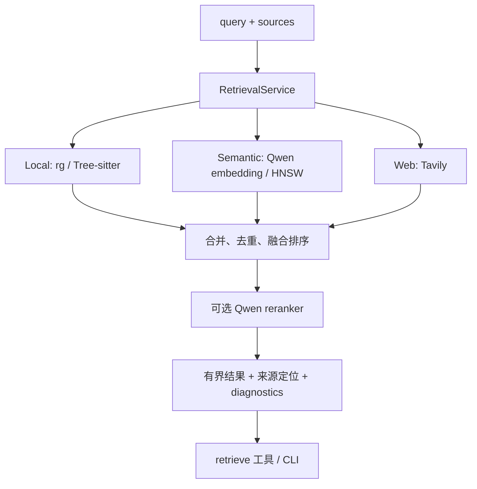

# RAG：可选的统一检索工具



RAG 不嵌入强制问答流程。CLI 可独立检索；agent 通过可选 retrieve 工具使用，模型决定何时调用。返回的来源供回答引用，检索层不替模型生成最终答案。

## 分层与模块

| 目录 / 文件 | 实现 |
| --- | --- |
| `local/search.py` | 使用 ripgrep 搜索文字或正则，限制扫描与返回范围 |
| `local/syntax.py` | Tree-sitter 提取代码符号，用于 symbol 搜索与代码分块 |
| `semantic/chunks.py` | 读取文本/PDF，按文档标题、段落或代码类/函数分块 |
| `semantic/encoder.py` | 本地 Qwen3-Embedding-0.6B，批量编码文本和查询 |
| `semantic/store.py` | SQLite metadata、NumPy vectors、HNSW ANN，增量更新与原子发布 |
| `web/search.py` | Tavily 官方库，保留 URL、标题、内容与分数，限制内容长度 |
| `ranking/qwen.py` | Qwen3-Reranker-0.6B 对粗召回候选重新排序 |
| `device.py` | 统一选择模型计算设备 |
| `knowledge.py` | 解析知识库与索引位置，读取已建索引的来源配置 |
| `service.py`、`types.py` | 统一结果类型、后端调用、去重、融合排序、重排和失败诊断 |
| `cli.py` | index / update / search 命令 |

Local Search 不需要建立向量索引；适合已知文件名、符号或关键词。Semantic Search 用于表达不完全一致的相关内容；首次建立索引需要下载并加载本地模型。Web Search 需要 Tavily key，搜索结果是摘录，必要时通过独立 fetch_url 工具进一步阅读。

## 原文、索引与增量更新

知识文件可以放在项目 `knowledge/`，也可以放在外部目录。原文和输出目录独立指定；索引可放在原文目录下的 `.index/`，扫描会排除索引目录。输出目录不能等于或包含原文根目录。

```text
knowledge/
├── notes.md / manual.pdf / source.py
└── .index/
    ├── CURRENT                  # 当前发布的 generation
    ├── LOCK                     # 更新锁
    ├── texts/<hash>.txt          # 提取并切分后的内容
    └── gen-<id>/
        ├── metadata.sqlite      # 来源、hash、chunk 定位、索引设置
        ├── vectors.npy          # 向量数组
        └── hnsw.index           # ANN 索引
```

更新按内容 hash 识别新增、修改与删除，复用未变化的 chunk 和向量。新 generation 准备完整后切换 CURRENT，读取者不会看到半套 SQLite/NumPy/HNSW 文件。查询直接读取已提取的 chunk 内容，无需每次重新解析 PDF。

这是增量编码加快照发布，不是对所有持久文件逐字节原地更新；ANN 构建与快照仍有成本。旧 generation 和文本缓存不自动 GC，长期使用需关注磁盘空间。改变分块参数、embedding 输入设置等会触发兼容性检查，不能将不同空间的向量混用。

## 构建与查询

在项目根目录执行：

```sh
uv sync --extra local-models
uv run ajagent-rag index --knowledge knowledge --index knowledge/.index
uv run ajagent-rag update --index knowledge/.index
uv run ajagent-rag search '相关设计是什么' --sources semantic --index knowledge/.index --no-rerank
uv run ajagent-rag search 'class_name' --sources local --local-path /absolute/path/to/code --mode symbol --no-rerank
```

update 从索引记录读取原文位置，因此仅指定 index 即可。CLI 路径相对当前命令目录；外部知识库使用绝对路径最直观。更多组合参数通过 `uv run ajagent-rag --help` 查看。

## 作为 agent 工具

在 `config/tools.local.toml` 的 `[tools].enabled` 中添加 `"retrieval"`。配置 `config/rag.local.toml`：

```toml
[rag]
sources = ["local", "semantic"]
knowledge = "../knowledge"
index = "../knowledge/.index"
local_path = ""
device = "auto"
rerank = true
```

空 local_path 使用 workspace；指定绝对路径即可搜索外部目录。index 也可指向外部知识库索引。业务配置路径相对最外层配置入口，所以默认 config/ 下使用 `../knowledge`。

需要联网检索时加入 source `"web"`，并在本地 `[tavily]` 设置 api_key。Tavily 使用官方 SDK，一次请求失败即返回诊断，不做自动重试。`max_content_chars` 限制每条内容长度。

```sh
uv run ajagent '使用 retrieve 查找资料，回答时给出来源和定位'
```

## 排序、设备与边界

多个来源先做去重与融合排序，再可选 Qwen 重排；`rag.candidates` 控制粗召回规模，最终返回数另受工具参数与限额约束。可在 CLI 使用 `--no-rerank` 排查检索层，或通过 `rag.rerank` 关闭重排。后端或重排失败会返回诊断；可用的其他来源仍能提供结果，不能把降级当作完整成功。

embedding 与 reranker 共用设备选择，`device="auto"` 选择可用加速设备；支持 CUDA 的 PyTorch 环境可使用 RTX 3080 Ti。模型会消耗显存，批量大小、输入长度与候选数影响内存和延迟，相关限额集中在配置中。

结果附带来源 URI 与定位；存在引用不等于证据支持结论。索引记录的是构建时内容，原文变化后需 update；搜索为空和后端失败是不同情况。索引发布有锁，但没有分布式更新、自动事实核验或索引 GC。

主流程与配置职责见[架构](../../../docs/architecture.md)，日常命令见[项目 README](../../../README.md)。
