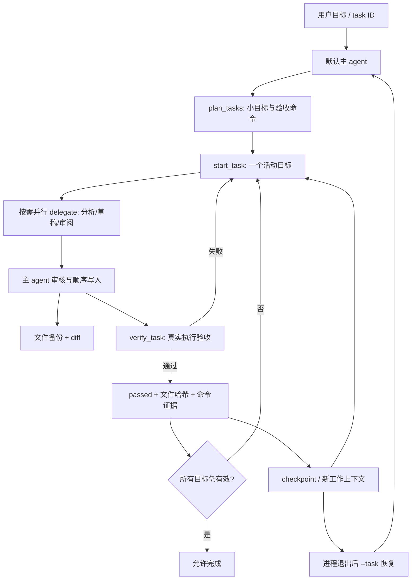

# 长任务与恢复



默认运行模式是主 agent 动态决策、动态委派。Stage 7 固定 research workflow 保留作对照实验，不用于默认长任务；无需显式指定角色链。

## 使用与配置

工具开关统一在 `config/tools.local.toml`，启用 `tasks`。模型对复杂任务调用 plan_tasks；简单任务不必创建计划。每个目标指定 id、title、acceptance、paths（需验收的文件）和 checks（argv 数组，无 shell）。执行命令受既有权限、允许命令和时间预算约束。

```sh
uv run ajagent '实现一个有测试和文档的小型 Python CLI，建立可恢复计划并逐项验收'
uv run ajagent-task list
uv run ajagent-task show TASK_ID
uv run ajagent --task TASK_ID '根据已有进度继续'
```

使用外部 workspace 时，以上命令均加 `--workspace /path/to/project`。`--task` 开新会话并读取事实进度；`--resume SESSION_ID` 延续原会话，也会恢复其绑定任务。二者同时使用必须指向同一任务。任务锁使用 POSIX flock（当前支持 Linux/macOS），进程退出自动释放，禁止两个主 agent 同时改同一任务。

`config/tasks.local.toml` 定义任务数/文本/检查/文件上限和 compact_on_checkpoint。max_idle_steps 默认 12：长时间只有观察而没有文件工具修改或任务状态更新时，提示收敛到下一验收/修改，不自动增加预算或假装进展。默认 checkpoint_task 或 verify_task 通过后，在下一完整协议批次边界切换工作上下文：保留当前用户请求、项目规则和落盘进度，不再反复发送所有旧工具内容。原始 session 消息、累计用量和审批记录不删除。关闭 compact_on_checkpoint 可继续使用普通上下文压缩。

当前运行配置默认上限为 100 steps、300 次工具调用、200 万 token、30 分钟；单次输出 8,192 token、命令 30 秒。子任务为 16 steps / 30 工具调用 / 10 万 token / 5 分钟，并受父预算限制。这些都是上限，不是预先消耗量；仍需按模型费用和任务调整。恢复开启新运行预算，不自动无限续跑；session 累计 token 语义不变。

`[harness].auto_approve_tools` 是明确配置的自动批准列表，deny 优先。默认仅批准内部 plan/start/checkpoint/verify 工具；verify 内部的 run_command 仍需命令执行权限。无人值守编码需在专门的 workspace 配置中显式允许 write_file/run_command/run_python/apply_proposal 等。主配置不默认放开这些副作用。

## 模块与状态

- `plan.py`：TaskOptions，配置验证。
- `progress.py`：唯一活动目标、原子持久化、文件哈希、验收与恢复、工作上下文交接。
- `feedback.py`：用户纠正候选；只经显式审核写入 Memory。
- `cli.py`：查看任务、提交/接受/拒绝反馈。
- `tools/tasks/tracking.py`：统一工具入口的 task 工具 schema；子 agent 默认不持有这些工具。
- `tools/files/history.py`：文件工具写入前备份、完整 diff、原子替换及按哈希回滚。
- `tools/common/persistence.py`：共享标识符校验和原子 JSON 写入。

状态为 pending / running / passed / failed。仅 verify_task 的真实检查全部 exit 0、required paths 存在且检查期间内容未变，才能标 passed。验收命令可以生成此前不存在的产物；已有文件若在检查期间改变则不标通过。拆分文件后可用 update_task_paths 更新未通过目标的路径并记录原因，原验收条件和命令不变。开始/查看/完成时会重新核对已通过项的文件哈希；文件变化或缺失会退回 pending，不能靠旧测试结果宣告完成。验收质量取决于指定检查，空测试或总是返回 0 的脚本并不能证明业务正确，因此编码试验另做独立黑盒审计。

运行中断时 running 保持未完成。新会话从任务记录关联到上一 run 的 pending checkpoint；可能已发生但结果未知的副作用仍会阻止续跑，必须人工检查后使用现有 `--acknowledge-unknown`，不会因为换了会话就自动重放。

```text
.ajagent/tasks/<task_id>/
  tasks.json              # 唯一权威状态，包含 checks、哈希和实际验收结果
  progress.md             # 给人阅读的进度投影
  checkpoints/000001.json # 历次任务快照
  feedback/<id>.json      # 待审核/已接受/已拒绝用户纠正
.ajagent/changes/<id>/
  before.bin              # 文件写入前内容
  change.diff
  change.json             # 前后哈希、路径和状态
```

write_file 和 apply_proposal 的实际写入都经过 FileHistory。工具返回 change_id，restore_file 只有在当前文件仍匹配该次修改后的哈希时才能恢复，避免覆盖后来编辑；新建文件恢复为不存在。run_command/run_python 任意脚本产生的修改、数据库和外部副作用不在文件回滚范围内；不能把文件恢复称为整次运行回滚。

## 用户反馈

```sh
uv run ajagent-task feedback TASK_ID '这个项目优先使用 unittest，避免额外测试依赖'
uv run ajagent-task accept-feedback TASK_ID CANDIDATE_ID
uv run ajagent-task reject-feedback TASK_ID CANDIDATE_ID
```

候选来自显式用户输入；下次 task 恢复可见。默认不加入长期记忆，agent 自己的反思不会自动获得用户认可。接受才写入 workspace Memory，重复接受不会创建重复条目。已接受记忆仍可用 ajagent-memory 删除。

## 验证与边界

离线测试真实启动一个子进程，在三段任务的第二段退出；新 Runner 恢复后只完成未通过目标。覆盖失败不能伪装 passed、文件变化使验收失效、未知副作用、锁、备份冲突、反馈审核、检查点上下文和累计用量。

实际试验项目为 `examples/projects/expense_tracker`，由本项目 agent 编写；测试结果与失败改进见 `docs/experiments/long-task-validation.md`。独立审计脚本：`uv run python evals/long_task_audit.py`。不实现后台常驻、自动无上限重启、跨机器调度或环境整体回滚。

参考 [Anthropic 长任务 harness 文章](https://www.anthropic.com/research/effective-harnesses-for-long-running-agents) 的小目标、事实进度与实际测试原则；本项目采用默认主 agent 动态委派，未使用其 Agent SDK 或固定 initializer/coder 工作流。
