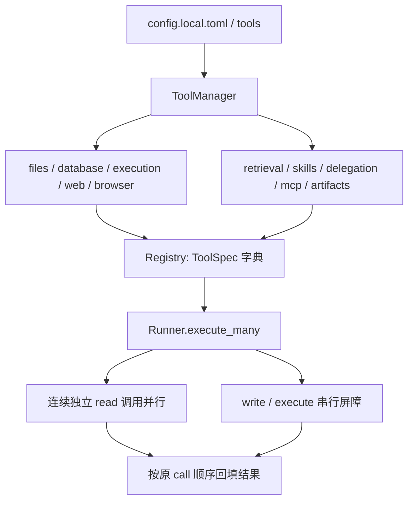

# 统一工具体系



只有 `tools/runtime/loader.py::ToolManager` 组装工具。`common/registry.py` 只负责参数解析、JSON Schema 校验、调用与结果序列化，不再包含只加载 files/database 的 build_registry。CLI 和 Runner 构造器不再分别增加业务工具。

## 单一配置入口

```toml
[tools]
enabled = ["files", "database", "execution", "web", "skills", "delegation", "artifacts"]
disabled = []
skills_path = "../skills"
mcp_config = "mcp.local.toml"
```

`enabled` 指能力组；加 `retrieval` 开启 RAG，加 `browser` 开启浏览器，加 `mcp` 连接 MCP 配置。`disabled` 是单个工具名的排除列表，也约束子 agent。启动时会打印实际注册的工具。选择空列表即可不注册任何工具。显式配置启用但依赖或配置有误时会报错；浏览器未安装/不能启动则提示并省略其工具。

RAG 的 sources/index/local_path 等仍放 `[rag]`；模型与 key 仍在厂商配置段。这些是能力的参数，不是另一套启用开关。`--rag`、`--rag-*`、`--browser`、`--mcp-demo` 以及 `[rag].enabled` 已移除。换场景使用不同 TOML，再传 `--config`；独立 `ajagent-rag` 的构建/查询参数仍保留。

## 目录职责

| 目录 | 职责 |
| --- | --- |
| common | ToolSpec/ToolError、通用分发、来源记录 |
| runtime | ToolConfig、ToolManager、资源装配与清理 |
| files / database | 文件读取/检索与 SQLite 查询 |
| execution | 工作区写入、命令和 Python 子进程 |
| web | HTTP 正文抓取与 Playwright 页面 |
| retrieval | RAG 对外工具适配，核心系统仍在 ajagent/rag |
| skills | metadata 发现、正文加载与 load_skill 工具 |
| delegation | task contract、隔离 worker、草稿/补丁提案与主 agent 应用 |
| mcp | 持久多 server client/manager、stdio/HTTP 传输 |

旧 extensions 目录已移除，所有能力从这个入口注册。根目录只保留包标记和文档。

## Skills

启动时只将 name/description 放进 available skills。模型可以调用 `load_skill(name)` 获取正文；用户也可以使用 `/skill name 任务`，两者共用 loader。加载不会注册新工具、放宽权限或更改 task contract。首版 front matter 仍只支持单行 name/description。

## 并行与顺序

同一步中的连续只读调用使用线程池执行，按原始 call 顺序回填，避免 provider 的协议批次错乱。一项失败不会丢失其他结果。写入/执行是屏障：等待前面的读调用结束，逐项执行，再允许后面的读调用。

`ToolSpec.parallel=False` 用于线程关联或共享可变状态：Playwright 必须在主线程按页面顺序操作；RAG 的共享模型缓存在内部加锁，避免多个 worker 同时初始化/使用；child propose_patch 写内部产物，也按顺序执行。MCP 在不同 server 间并发，同一 server 请求排队。read 并不自动意味着实现线程安全。

`[limits.capabilities]` 的 `read_workers=4` 和 `subagent_workers=3` 控制并发上限。预算对正在进行的模型请求预留“估算输入+最大输出”，并以实际 usage 结算；所有父子预算共享锁，避免两个 child 各自认为同一额度还可用。Token 估算并非厂商 tokenizer 的严格上界，真实费用超限仍会如实累计并停止后续请求。

## Task contract 与 single writer

主 agent 在同一步返回多个 `delegate` 调用即可并行拆分任务。每个调用必填：

```json
{
  "contract": {
    "goal": "审阅 parser.py 并提出更易读的实现",
    "context": "保留公开函数签名，不增加依赖",
    "acceptance_criteria": ["保留现有行为", "解释修改理由", "提供可审阅提案"],
    "allowed_paths": ["src/parser.py"]
  },
  "role": "reviewer"
}
```

每个 child 使用独立 Session、ContextBuilder、模型适配器和预算；共享只读工具白名单、父级 deny/tool hooks，无父历史副本、无递归、无 workspace 写入/执行工具。contract 的 allowed_paths 是提案输出范围，不是额外的读取沙箱。上下文、验收标准通过显式 contract 传递。

child 可调用 `propose_patch(path, base_sha256, content, rationale)`。`read_file` 返回整文件 SHA256；新文件使用空字节 SHA256。提案保存完整候选内容、生成的 unified diff、基线 hash、理由与 contract 到 artifact，工作区保持不变。

主 agent 接收按调用顺序返回的 status/summary/evidence/proposals/artifacts：先 `inspect_proposal` 查看 diff，结合 contract 和其他子任务进行逻辑审阅，再 `apply_proposal(artifact, review)`。应用需要权限确认，顺序执行，检查基线变化与 Python/JSON/TOML 语法；同一文件的旧基线提案在前一项应用后会冲突，必须重新生成，不能静默覆盖。语义冲突无法自动证明不存在，review 由主 agent 负责，配置的验证命令可继续运行测试。

失败或超时的 child 返回独立状态，主 agent 可以继续解释/处理；Ctrl-C 传播取消。ThreadPoolExecutor 不能强杀正在执行的 Python handler，退出会等待已启动工作，HTTP/MCP/进程等仍由各自超时约束。主线程负责权限、hooks、结果落盘；child 的模型用量和事件通过锁安全汇入父任务。
