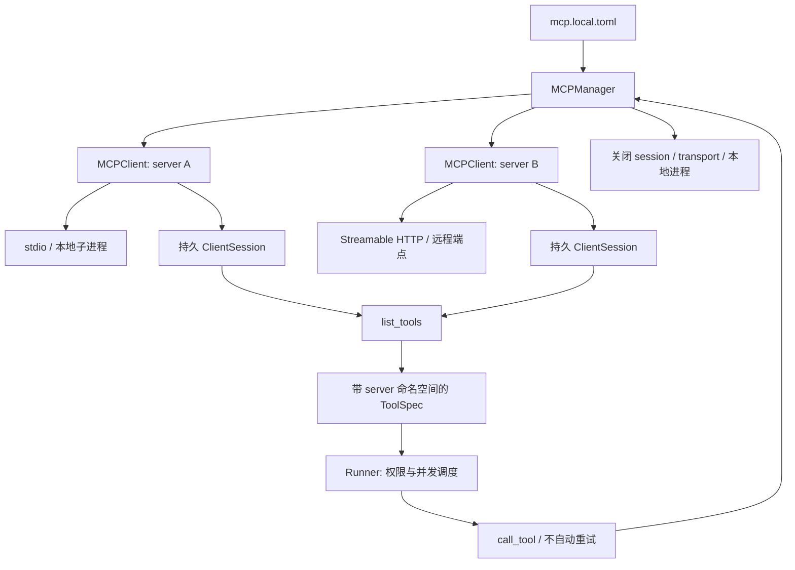

# MCP 子系统



MCP 是统一工具体系中的一个子系统。`ToolManager` 根据 `[tools].enabled` 决定是否启动它；`registry.py` 不知道任何具体 server 或 transport。这里只使用官方 MCP 协议 SDK，不使用 agent 编排 SDK。

## 配置

先安装 `uv sync --extra mcp`（需要所有可选能力时使用 `--all-extras`），将 `config/mcp.example.toml` 复制为忽略的 `config/mcp.local.toml`，主配置中设置：

```toml
[tools]
enabled = ["files", "artifacts", "skills", "mcp"]
disabled = []
skills_path = "../skills"
mcp_config = "mcp.local.toml"
```

MCP 配置示例：

```toml
[servers.demo]
transport = "stdio"
command = "${PYTHON}"
args = ["mcp/add_server.py"]
cwd = ".."
read_tools = ["add"]
timeout = 10
enabled = true

[servers.docs]
transport = "http"
url = "https://your-server.example/mcp"
read_tools = ["search", "fetch"]
timeout = 30
enabled = false

[servers.docs.headers]
Authorization = "Bearer ${DOCS_MCP_TOKEN}"
```

`${PYTHON}` 在 command 中指当前虚拟环境解释器。headers/env 支持 `${ENV_NAME}` 展开；启用的 server 缺少环境变量时启动报错。stdio 的 cwd 默认是 MCP 配置文件所在目录；可以显式覆盖。选择启用本地 server 就表示允许启动该配置中的程序，模型不能修改 server 启动配置。

工具名为 `mcp_<server>_<tool>`，例如 `mcp_demo_add`。名称归一化后的冲突或超出 64 字符会报错，不会静默覆盖。服务端的 `readOnlyHint` 不会自动给予读权限；仅本地 `read_tools` 列表中的工具按 read 调度，其他工具均走 execute 审批及串行屏障。填入 read_tools 即表示你信任该方法没有业务副作用。

## 模块与生命周期

- `config.py`：读取并验证 server 配置、传输类型、参数、超时、环境变量与凭据。
- `client.py`：每个 server 一条专用线程/事件循环，一个 owner task 负责进入和退出所有 SDK context manager。初始化一次，发现一次，持续复用 session。调用经队列发送；同 server 请求顺序处理，不同 server 可并行。
- `manager.py`：同时管理多个 client，生成 ToolSpec、关闭连接、显式 `reconnect(name)`。其中一个 server 启动失败会关闭已启动的 client，防止半初始化状态。
- 根目录 `mcp/`：独立测试服务器；客户端包不再包含 demo 实现。

线程解决同步 Runner/Playwright 与异步 MCP SDK 共存的问题，也保证 AnyIO 的 context manager 在同一 task 里退出。应用结束时 `ToolManager` 统一关闭资源；stdio 子进程在连接生命周期内保持存活，不再每次调用重启。

SDK 负责协议初始化、请求 ID、消息解码和 Streamable HTTP 会话协议。HTTP 支持 headers 认证；当前没有 OAuth 登录流程，也不支持旧版独立 HTTP+SSE transport。配置 `http` 指现代 Streamable HTTP，其响应可以是 JSON 或 SSE，不能将它理解为完全不使用 SSE。

## 失败语义与边界

连接、请求与关闭有超时，错误返回结构化 ToolError，原始认证 headers 不进入错误文本。请求失败不自动重试，尤其不重放可能已生效的 execute 调用。发生超时时远程操作可能仍在运行，不能声称已撤销副作用。需要重连时调用 `MCPManager.reconnect`，它只重建连接，不重发过去的操作。

当前面向 tools/list 与 tools/call；没有把 resources/prompts/sampling/OAuth 全套协议暴露为 agent 工具。工具 schema 在连接时缓存，新增或变更工具后显式重连并重新装配 registry。进程退出/断连可能直到下一次调用才被观察到。

验证见 `tests/test_mcp_system.py`：真实 stdio 服务 PID/计数证明连接复用，多 server 命名空间、显式重连、线程清理；真实本地 Streamable HTTP 服务验证连续调用；另有无响应服务、权限和浏览器共存回归。

实现依据：[官方 Python SDK](https://github.com/modelcontextprotocol/python-sdk) 与 [MCP 传输规范](https://modelcontextprotocol.io/specification/2025-06-18/basic/transports)。
